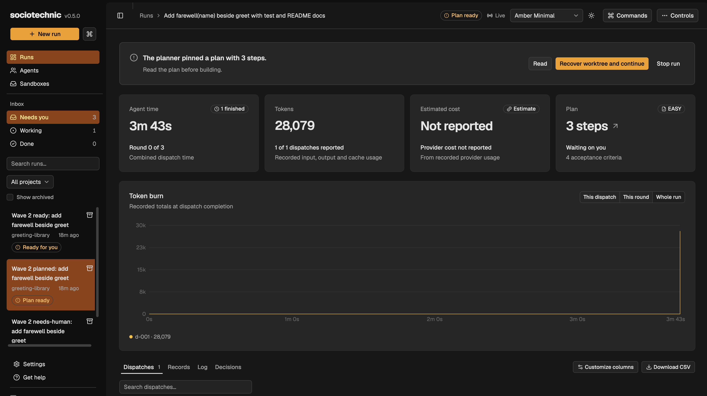
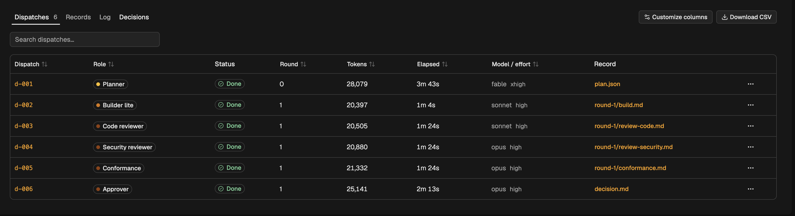
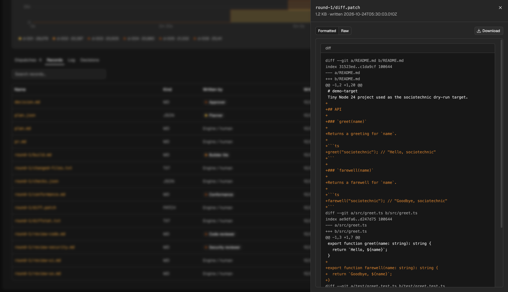
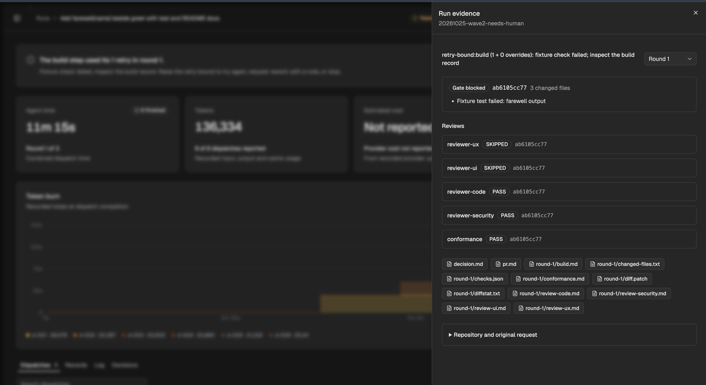
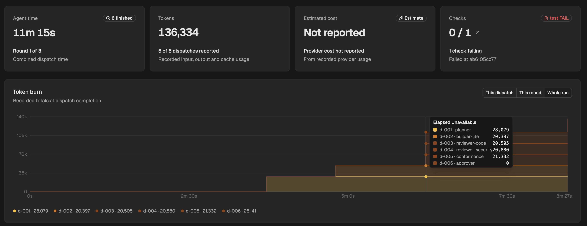
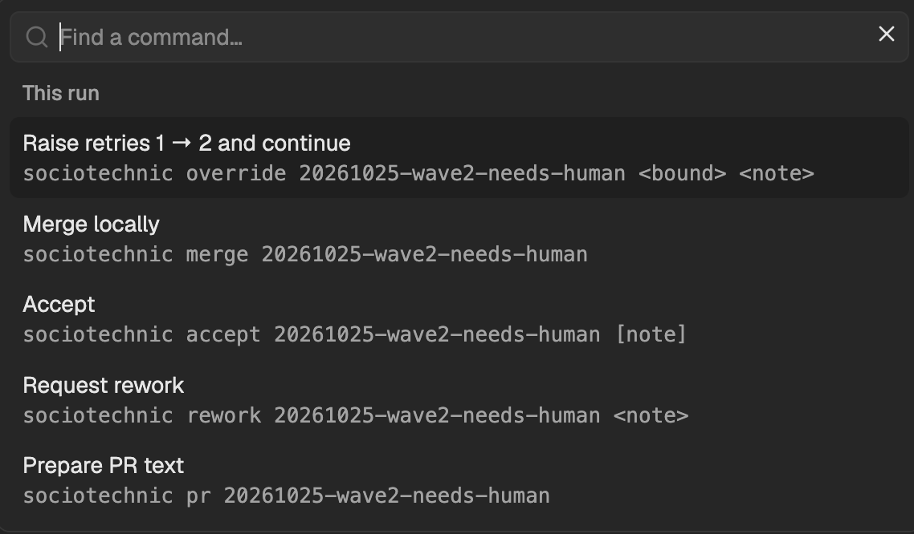
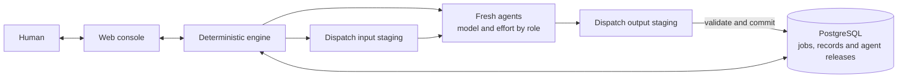
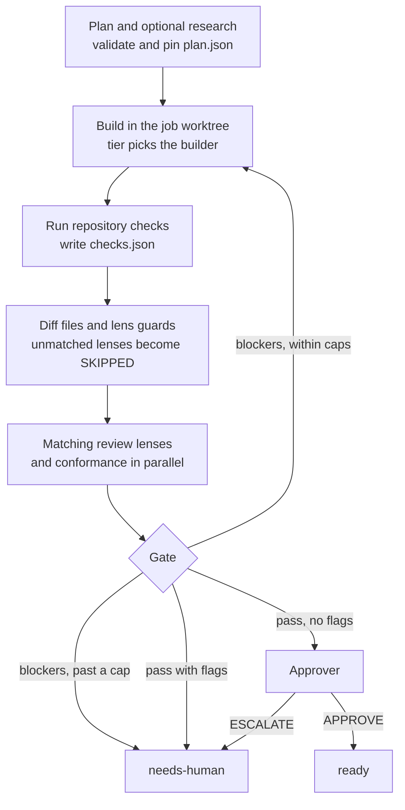

Sociotechnical (or sociotechnic) refers to the interlinked relationship between people (social systems) and machines, tools, or software (technical systems) within organizations and society. The theory states that an organization or system works best when its social and technical parts are designed together to fit each other, rather than optimizing technology alone.

Human behavior, culture, and values shape how technology is used, while technology simultaneously changes how people work and communicate. Speak like a human. Ship like a machine.

We invite you to join us. Be Sociotechnic.

Sociotechnic turns a development task into a safe, isolated branch you can test, review and merge with confidence. Start a run in the web console, review its plan, and follow the work through building, checks and independent reviews. The engine coordinates fresh coding agents and stops when it needs your decision.

The console is the intended main interface. The engine and semantically versioned agent definitions live in this repository. PostgreSQL stores job records across projects and versions. The CLI and HTTP API support further automation and development against Sociotechnic itself.

[Start a run](#start-a-run) · [Agent library](#agent-library) · [Follow the work](#follow-the-work) · [History](#history) · [Review and decide](#review-and-decide) · [How it works](#how-it-works) · [Technical documentation](#technical-documentation)

Screenshots show demonstration runs. The console is evolving, so some views show earlier layouts.

## Start a run

For a first-time installation, follow [local setup](sociotechnic/docs/development.md#local-setup). Once the console is running, open [the local console](http://127.0.0.1:4747).

1. Choose **New run**.
2. Enter a repository path or choose **Browse** to select a folder or create one with **New folder**. Browsing starts at `~/Prog` when available, otherwise your home folder. Enter a path and choose **Go** to save a different starting point for future sessions in this browser. Add an optional base branch and a description of the change. Say who it is for and how you will know it worked.
3. Choose **Start planning**. With **Initialize Git if needed** enabled, a new folder gets a `readme.md` containing `tbd`, a generic `.gitignore`, and an initial commit. Existing starter files are preserved; other files stay untracked. Sociotechnic then creates a job branch and a separate worktree in which agents make their changes.
4. Read the plan. The React console always pauses before building so you can check its scope and acceptance criteria.
5. Choose **Continue build** when the plan is right. To change the pinned plan, stop the run and start another with a revised request.

Choose **New repository** for a fresh project. It commits the starter README and
ignore file, creates a private GitHub repository at the shown destination and
publishes the base branch before planning. Your run's changes still need acceptance
and **Push and open PR**. If UI work has no existing
scaffold, the design interview suggests our React + NestJS house special. You
can request another scaffold; you choose the stack before implementation.

New run also offers **Docker Sandbox — experimental**. The run's agents and
checks share an isolated local Linux environment with explicit CPU, memory and
concurrency settings. Your source checkout is not mounted. Committed work returns
to a local review worktree for the same testing, acceptance and merge decisions.
Your environment choice and valid CPU, memory and concurrency settings are saved
automatically in this browser for future runs, even if you cancel the dialog.

Keep a clean slate: choose the total **sandbox slots** for this installation
separately from the workers inside each run's sandbox. Each run gets its own
CPU and memory limits. Use **Sandboxes** to see retained runs, stop them, or
remove their sandbox and worktree without losing the recorded history.

When you finish a run locally or confirm its GitHub merge, its sandbox is removed.
Dirty or unexported work blocks cleanup and stays visible for recovery; it is never silently discarded.

Local execution is the initial default. [Setup, storage and cleanup](sociotechnic/docs/docker-sandboxes.md).

For [comment and docblock cleanup](sociotechnic/docs/comment-cleanup.md), choose **Comment cleanup** and enter the files or directories to inspect. The engine prepares a scope inventory and plan for review, then a coordinator assigns fresh Sicko workers. The same checks, reviews and human decisions apply.

## Design before implementation

Choose **Design conversation** in **New run** and use **Local** execution. This
is a normal Claude Code agent with the installed `/impeccable` command. Talk back
and forth, attach or paste images, and let Impeccable open its native preview
windows. The conversation and its images remain in history.

The design conversation replaces the dashboard cards while it waits for your input. Native questions, image attachments and **Open previews** stay with the conversation. The assignment may call for a plan, samples, prototypes, a page or a critique.
The agent prepares Markdown in `HANDOFF.md`; **Return work** sends it and its
artifacts to the caller. For initial design work, the planner reads that result
and decides what comes next. The chat stays available for follow-up. Ordinary
feature planning can also request design, including another specific assignment.
Docker design sessions are not yet supported.
[Interactive design details](sociotechnic/docs/design-ceremony.md).

## Follow the work

The inbox groups runs into **Needs you**, **Working** and **Done**. Search or filter by project, and use **Show archived** to restore hidden runs. Archiving preserves records and does not stop active work.

The run dashboard puts the next decision above four cards: **Agent time**, **Tokens**, **Estimated cost**, and the current plan, checks or approval. Open a card for its recorded evidence. The token chart shows completed dispatch reports in role colors; select a dispatch to inspect its measurements, model, effort, deadline and log. Missing usage stays unreported, and provider cost is an estimate.

Use **Dispatches**, **Records**, **Log** and **Decisions** below the chart. Customize dispatch columns or download the filtered visible columns as CSV. Records open in a right-hand sheet with Formatted, Raw and Download controls. Earlier rounds remain available through Records and the round selector in the evidence sheet.

**Controls** offers Pause, Step once, hold after a chosen transition and raise a bound before it trips. The dispatch sheet can **Interrupt dispatch** with a note while its siblings continue. **Settings** holds local concurrency, sandbox capacity, theme and the default transition holds for new runs in this browser. **Commands** (⌘K or Ctrl+K) lists the actions legal now and their CLI equivalents; ⌘B or Ctrl+B toggles the sidebar.

Checks and reviews retain their commit binding. Stale evidence never becomes a passing headline, skipped lenses remain **SKIPPED**, and missing measurements are never a reported zero.

For an externally owned run, **Open owning console** takes you to its controls. Records stay readable here; **Refresh status** checks ownership again. Continue uses the normal recovery checks when a previous driver stopped or a runnable run lost its worktree. For an eligible missing worktree, **Controls → Restore worktree** recovers it and keeps the current run status without starting agents. **Recover worktree and continue** recovers it and starts the driver.

In **Settings → New run defaults in this browser**, choose where future runs
should hold after planning, building, checks or review, then choose **Save run
defaults**. Plan review is always required. New runs keep the saved choices when
you continue them; changing the defaults leaves existing runs unchanged. A
one-run hold in Controls applies only to that start. Storage failures appear
beside the setting and leave the previously saved defaults in place.

## History

Choose **History** in the sidebar for recorded work across projects, or **Run
history** on a run for its own measurements. Filter by run, project and archive
state. Open a total, completion day, feedback category or role/round to inspect
the contributing dispatches. The page shows reported tokens, estimated cost,
agent time, separate outcomes and checked builds, with measurement coverage.
If the cohort is limited, narrow the filters to inspect a complete view.

Open a dispatch or source record to read the evidence in the run's existing
sheets. The selected run, dispatch and record survive reload through the page
address. Missing data stays unknown; partial totals stay labelled. Provider
cost reports are estimates, cache reads are part of total tokens, and human
acceptance is context rather than an accuracy score.

## Agent library

For UI work that needs browser verification, choose the browser builder or browser
builder-lite in New run's agent assignments. They use isolated browser sessions
for rendered checks and diagnostics. [Setup and scope](sociotechnic/docs/browser-verification.md).

Choose **Agents** in the sidebar to browse the whole team across
projects and runs. Each role has a distinct icon shared with run profiles,
activity and analysis. Search by role, model or description, then inspect when
it is called, its model and effort, allowed tools, limits and explicit skill
access. Operator-installed skills are not automatically granted to agents.

Choose a run in **In run**, or choose **Run agents** from its dashboard, to
inspect its pinned assignments and releases. Tools, skill access, models,
effort and budgets come from that run's configuration. Global profiles show
the latest release. Counts open their contributing deployments; feedback and
checked builds link to their exact source records. Configuration comparisons
keep their workflow, tier, model, effort and release when you inspect a count.

History reads database runs, including archived runs, counting each deployment
once. Explicitly marked development cancellations remain in execution history
and are excluded from performance metrics. Completed calls, execution errors,
timeouts, interrupted calls, pending calls, malformed records and valid requests for changes stay separate. Feedback categories retain
re-asks, type checks, tests, lint, build checks, review findings and human rework
with their deployment, reporter and source. Check/review feedback identifies the
builder at the matching round and commit; it does not prove who caused a defect.
Nested comment workers are not independently counted by engine dispatch history.

Use **Longest running** or **Errors & feedback** to inspect recurring work before
turning it into tools or deterministic checks. Compare workflow, build tier, model,
effort and definition revision alongside timing and token coverage. New deployments
capture a definition fingerprint; older ones remain **Version unrecorded**.
All initial agents start at **v1.0.0**. Icons and names share meaningful colors
that adapt to light and dark backgrounds. New agents inherit their role's icon
and color, so the same identity follows them through run evidence.

To **add an agent**, open **Agent library → Add agent**. Give it a unique name,
purpose and role template. Write instructions, import a Markdown/text file, or
start from the template. Keep the template's required output format. Review the
agents already doing that job and explain the distinct responsibility. Exact
copies are rejected; use a new version when the responsibility is the same.
Review the model, tool subset and budgets, then create **v1.0.0**.
Compatible reader and ordinary builder templates offer both **Anthropic / Claude** and **OpenAI / Codex**
model groups. Codex uses your saved ChatGPT login and requires access to the
selected model. Creation makes
the agent available; it does not change any run. In **New run → Agents and
versions**, assign it to its matching role and choose latest or a legacy release.

The optional [Azure SME](sociotechnic/docs/azure-sme.md) uses **GPT 6.1 Sol / high**
and pinned Microsoft Azure skills. Search `azure` in
the library. Choose its planner for a plan another builder can execute, its
advisor for research and escalations, or **Azure Builder v1.1.0** for implementation
and small fixes. Select the same builder in both EASY and COMPLEX slots; each
tier retains its scope rules and execution budget. Assignments retain the
workflow's plan, check and human gates.

To **modify an agent**, select it in the library and choose **Manage versions**.
Copy an existing release, edit its purpose, instructions, model, effort, tools or budgets,
and review then publish a higher version. Use a **patch** such as 1.0.1 for
corrections, a **minor** such as 1.1.0 for compatible capabilities, and a **major**
such as 2.0.0 for changed expectations. Releases are immutable and ordered
numerically. New runs pin latest unless overridden; existing runs keep their
exact assignments, versions, instructions and settings.

Permissions stay within the role's limits; publishing cannot grant reviewers
shell access or bypass write guards. Planning, research, review, conformance and
approval agents can switch between Claude and OpenAI models when creating an
agent or publishing a version. Codex uses high effort; readers have fixed read-only
tools, while ordinary builders can edit, run commands and commit in their assigned
worktree. Design and Agent-worker templates require Claude. Nested comment
workers retain v1.0.0 and are not editable independently yet. File imports supply
instructions only; imported hooks, tools and skill declarations are ignored.

**PostgreSQL is the agent catalog.** Releases and run bindings are backed up and
restored with the runs. There are no live agent Markdown files to edit in the
repository. Committed migration bundles carry the complete release history,
including older versions, instructions, tools, model choices and custom agents.

Catalog changes are exported and checked before committing; upgrading imports
missing releases without replacing an existing version. A database outage blocks
job and catalog operations. See the [catalog and recovery
guide](sociotechnic/docs/engine-reference.md#semantic-agent-releases) for migration
and backup details.

Agents also receive a concise capability roster, so they can recognize useful
specialists and ask for focused help. The planner can consult a registered advisor
within its bounded research round. Builders and validators keep ownership and
return concrete help requests to the assigner through existing records. New agents
appear automatically in new runs' rosters. [Agent discovery and help](sociotechnic/docs/agent-discovery.md).

Missing measurements stay unavailable. Definition fingerprints cover stored
instructions and role settings. Full release-content digests also bind bundled
skill snapshots. Neither proves how a provider alias resolved or captures every
generated dispatch brief.

Recorded feats currently recognize checked builds with build records, checks and
unflagged gates bound to the same commit. They link to run evidence. Human
acceptance is run context. These observations support future experiments; they
do not establish agent accuracy or automatically change models, prompts or
planner behavior. The screenshot uses the committed demonstration run.

## Review and decide

The decision bar names the current hold and its primary action. Choose **Read** for the plan, approval, diff or gate blockers in a sheet; secondary decisions stay in the quiet menu. Agents commit on the job branch; you decide when to test, accept, publish and merge.

| Run status | Your next decision |
| --- | --- |
| **Your design decision** | Continue the chat, answer native questions, share images or return the Markdown work product |
| **Planned** | Read the pinned plan, then choose **Continue build**, or stop and start again with a revised request |
| **Ready** | Inspect the evidence. Choose **Merge locally** to test in your normal checkout, or test in the job worktree, then **Accept** or **Request rework** |
| **Needs your attention** | Read the reason, blockers and policy flags. Request rework, raise the named bound when appropriate, or test and accept after reviewing the evidence |
| **Merged locally** | Test in your checkout, then accept or request rework. The job branch and worktree are kept |
| **Accepted** | Choose **Push and open PR**, then separately **Merge PR on GitHub**; or finish the run locally |
| **Stopped** | Choose **Reopen run** to continue with existing changes, or remove the worktree |

Acceptance confirms that you tested the change. Publishing and GitHub merging have separate confirmation steps; a passing gate alone triggers neither. A remote merge checks the published PR identity and commit, follows GitHub's merge requirements, and records confirmed success.

**Merge locally** changes your base checkout. **Merge PR on GitHub** preserves it. After a GitHub merge, synchronize that checkout separately; local and remote merge histories can differ. [Publishing and merge details](sociotechnic/docs/cli-reference.md#publishing-after-accept) explain the underlying operations.

Rework records feedback for a fresh build and review round. **Stop run** accepts an optional note and preserves work for reopening. **Reopen run** keeps edits unless you explicitly choose to discard them. **Prepare PR text** saves the record without publishing; **Push and open PR** and **Merge PR on GitHub** remain separate confirmed actions.

## How it works

The engine decides what runs next; the console’s driver executes that decision through the Claude Agent SDK or Codex CLI, according to the run’s pinned agent settings. Only one driver can own a job at a time. Alternative session and automation entry points are documented in the [CLI and driver reference](sociotechnic/docs/cli-reference.md).

The planner selects the build tier. The bundled defaults use Opus for complex work, Sonnet for localized changes, Haiku for mechanical sweeps, or a Sonnet coordinator and Sonnet workers for comment cleanup. Agent assignments and versions can select other compatible models before a run starts. Separate reviewers examine code, security, UX, UI and plan conformance where their path rules apply.

The gate checks records, commits, repository checks, worktree cleanliness and the pinned plan. Blocking findings open another round while the limits allow it. Policy flags or exhausted limits require a human decision. A clean gate goes to the approver before the run becomes ready.

PostgreSQL owns jobs, records, design previews, archive state and immutable agent releases. Local agent files are disposable staging. Missing staging does not hide a run or change its evidence; a database outage reports an error instead of switching to files. Restoring a worktree still requires the target repository and its job branch; the database does not back up commits or uncommitted edits.

## Technical documentation

| Document | Read it for |
| --- | --- |
| [Local setup and development](sociotechnic/docs/development.md) | Installation, running the console, development mode, tasks, checks, dependency policy and historical demo evidence |
| [CLI and driver reference](sociotechnic/docs/cli-reference.md) | Session and engine commands, the global skill, console lifecycle, publishing, HTTP API and driver handoff |
| [Engine and state reference](sociotechnic/docs/engine-reference.md) | All roles and tiers, records, gate rules, bounds, configuration, database migration and recovery |
| [Comment cleanup](sociotechnic/docs/comment-cleanup.md) | Starting a cleanup run, worker scope, bounded waves, proof requirements and limitations |
| [Behavioral contracts](sociotechnic/CONTRACTS.md) | The engine, agents, console and state-store specification |
| [Driver contract](sociotechnic/AGENTS.md) | How drivers execute engine decisions and observe human gates |

Agents adding capabilities should read the behavioral and driver contracts, then the relevant reference. The command and API documentation remains available for automation and CLI use.

Sociotechnic is an experiment under active development. Automated tests use fake agents; passing them does not establish live model quality or production reliability. [Historical runs](sociotechnic/docs/development.md#status-and-historical-runs) distinguish recorded evidence from reported outcomes.

## Contributing and license

Read [CONTRIBUTING.md](dox/CONTRIBUTING.md) to report a bug, propose a feature or open a
pull request. Follow the [code of conduct](dox/CODE_OF_CONDUCT.md) and use the
[security policy](dox/SECURITY.md) for vulnerability reports.

Sociotechnic is licensed under [MIT](dox/LICENSE). Bundled upstream material retains
its own [licenses and notices](dox/THIRD_PARTY_NOTICES.md). See the
[changelog](CHANGELOG.md) for releases.
