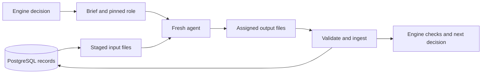

# Agent handoffs and prompt audit

This audit traces what Sociotechnic gives each agent, what comes back, how much data the handoff contains, and which promises the engine checks. It also compares the rebuilt planner with its older releases and records the review of shorter prompts for the other roles.

The existing architecture is sound in one important respect: agents hand back records, and the engine owns transitions. The main gaps are incomplete enforcement of record bodies, incomplete payload and context measurements, and duplicated policy across stored instructions and generated briefs. Prompt cleanup can reduce repetition now. Stronger automatic gates and context-aware continuation need separate engine changes.

The baseline is a read-only snapshot of the local PostgreSQL catalog and history on October 25, 2026: 28 jobs, 140 dispatches and 38 immutable agent releases. The reviewed updates were subsequently published as 20 new immutable releases; the publication record below distinguishes them from the baseline. No historical run should be used as proof that a shorter prompt improved quality: model, effort, turn budgets and task scope also changed.

## What actually crosses a handoff

An agent does not inherit the previous agent's conversation. Each ordinary dispatch starts fresh. The engine supplies a generated brief and the selected immutable role definition; the driver stages committed records for reading and accepts only assigned outputs. Agents pull the evidence they need from those paths.



Four different quantities matter:

| Layer | Contents | What the size means |
| --- | --- | --- |
| Role instructions | Pinned prompt body, selected model/effort/tools, and attached skill entrypoints | Text supplied to the role. Frontmatter and provider/tool framing have separate overhead. |
| Generated brief | Task, target paths, output format, relevant findings, retry feedback, roster cards and help rules | Direct dispatch text. Retained envelopes contain the pre-staging version, before adapter path rewrites and appended instructions. |
| Staged evidence | Committed records plus a serialized job snapshot; specialist reference files are materialized separately | Bytes available to read. Availability does not mean the model consumed all of them. |
| Active model context | Instructions, conversation, tool results and provider framing currently carried by one model invocation | The quantity relevant to context degradation. Current historical usage totals do not measure it. |

Claude receives the brief through SDK `query()` and the role body through the selected agent definition. Its project settings are enabled. Codex receives the role body, attached skill entrypoints, brief and adapter instructions together; its automatic project-document loading is disabled, so explicit target-root instruction reads matter. Sandbox execution transports the same work through a VM and adds setup/copy overhead. The runtime does not currently retain an exact account of all provider framing.

Attached skills inject their `SKILL.md` bodies and reference directories. Their complete reference trees are available for selective reads; the whole tree is not automatically injected. Capability rosters supply compact cards rather than every specialist's full prompt. See [brief construction](../src/brief.ts), [roster cards](../src/agent-roster.ts), [skill materialization](../src/agent-skills.ts), [Claude execution](../ui/runner.ts), [Codex execution](../ui/codex-runner.ts) and [staging](../src/staging.ts).

## The contract at each workflow boundary

| Phase | Receives | Returns | Enforced now and remaining gap |
| --- | --- | --- | --- |
| Planner | Feature, target repository, optional research/design records and human answers | Strict `plan.json`, optional `plan.md`, or recognized input/research/design request JSON | Required plan fields, tiers, stage IDs/counts, control forms and pinned digest are checked. Testability, accurate scope and useful acceptance evidence still require judgment. |
| Researcher or advisor | One bounded question and target repository | `STATUS: DONE` or `BLOCKED`, Answer and Evidence | Marker and minimum record size are parsed. Answer/Evidence presence and evidence quality are not fully validated. BLOCKED can return unresolved evidence to the planner; this is a legitimate decision path, not automatically a failed handoff. |
| Builder | Approved plan, worktree/branch, prior build, findings and failing-check evidence when relevant | `STATUS: READY` or `BLOCKED`, full COMMIT, acceptance and deviation evidence | Marker and commit are parsed; engine checks HEAD before canonical checks. Required body sections and acceptance coverage are largely prompt obligations. |
| Deterministic checks | Committed build HEAD and repository check configuration | `checks.json` bound to that HEAD | Engine runs configured checks. Failures open bounded repair work before review dispatches. Agent-reported checks do not replace engine checks. |
| Review lenses | Pinned diff, changed paths, plan, build and check records | `VERDICT: PASS` or `CHANGES`, COMMIT, Findings and Notes | Verdict, commit syntax and recognized finding severities are parsed. PASS with a recognized blocking finding fails; agents cannot write SKIPPED. Missing body sections or unrecognized finding syntax can escape structural detection. |
| Conformance | Review inputs plus the plan's stages | Review record plus Plan steps table | Supplied rows are checked for accepted status and required justification. The parser does not compare the complete row set against the pinned plan. Missing, duplicate or unrelated stage IDs can pass. |
| Approver | Records and engine-computed gate | `DECISION: APPROVE` or `ESCALATE`, COMMIT and reasons | Commit binding and decision marker are checked. Acceptance evidence and consistency rules depend on the approver's judgment. |

Interactive design is a separate human conversation using native Impeccable. Its artifact approval/digest belongs to that existing workflow. The designer should retain its short native definition rather than be forced into ordinary dispatch boilerplate.

Plan stages describe scope and acceptance groups. They are not separate scheduled builder calls: one build dispatch currently receives the complete plan. A future stage scheduler would change execution behavior and must be designed explicitly.

For example, a build hands back a Markdown record with this shape. Values below are illustrative, not a real run:

```markdown
STATUS: READY
COMMIT: 0123456789abcdef0123456789abcdef01234567

## Summary
Added the requested empty state.

## Acceptance
- [x] Empty results show the agreed message — verified with the named test and observed result.

## Deviations
- none

## Notes for reviewers
The changed path and the command/results needed to check the claim.
```

The next review brief names that build record, `plan.json`, `checks.json`, `diff.patch`, changed-file metadata and the exact HEAD. It supplies the lens and output contract. A reviewer returns PASS/CHANGES, the same COMMIT and structured severity bullets. On repair, the next fresh builder receives those findings and failing-check tails, plus paths to the retained evidence. It receives neither the previous model's private reasoning nor an inherited chat transcript.

Retries use fresh agents and preserve superseded record bytes. Plan digests, matching commits, clean worktrees, configured checks, immutable releases, driver leases, output allowlists and loop bounds remain substantial controls. Changes outside `plan.touches` produce a gate flag and park before approval under current policy; they must not silently become a new permission or a different failure rule. See [record parsing](../src/verdict.ts), [plan validation](../src/plan.ts), [workflow](../src/engine.ts), [gate](../src/gate.ts) and [driver contract](../AGENTS.md).

Staging rejects changed input files, undeclared output paths and symlinks, with storage ceilings of 32 MiB per output file and 128 MiB across a dispatch's output files. Verdict records need at least 50 bytes. These are integrity/storage limits, not useful text budgets or proof of substantive work.

## Payload size and timing

The retained pre-staging briefs are already larger than most individual output records. Their payload includes the task contract and team roster in addition to task-specific data. Shortening a role body helps, but does not remove that other overhead.

Baseline query at approximately 7:42 p.m. CDT on October 25, 2026:

| Step | Attempts | Provider outcome OK | Median issue-to-finish | 95th percentile | Retained briefs | Median brief bytes | Largest brief bytes |
| --- | ---: | ---: | ---: | ---: | ---: | ---: | ---: |
| Plan | 39 | 22 | 54.870 s | 577.661 s | 29 | 13,412 | 14,876 |
| Research | 1 | 1 | 23.484 s | 23.484 s | 1 | 9,695 | 9,695 |
| Build | 20 | 19 | 190.643 s | 1,268.486 s | 6 | 11,231 | 11,974 |
| Review, including conformance | 72 | 72 | 43.982 s | 129.788 s | 15 | 10,995 | 11,954 |
| Approval | 2 | 2 | 86.446 s | 129.031 s | 0 | Unknown | Unknown |
| Historical design dispatch | 6 | 6 | 540.135 s | 579.940 s | 6 | 17,887 | 18,221 |

These are mixed historical tasks, models, failures and retries, not a controlled performance comparison. Provider outcome OK does not establish record validity or accepted work. Issue-to-finish includes more than model generation and can include waiting and adapter work. Parallel durations overlap. Two approval samples and one research sample do not establish a reliable population percentile.

The longest planner issue-to-finish interval was 10 minutes 37.884 seconds. Usage counters accumulate across requests and cache reuse; they cannot establish whether active context reached 200k. The baseline has no dispatch using the pasted planner's then-latest 1.0.6 release, so it cannot establish that version's measured outcome.

Output record sizes in the same baseline:

| Record class | Records | Median bytes | Largest bytes |
| --- | ---: | ---: | ---: |
| Canonical plan | 20 | 5,482 | 29,401 |
| Build and retained build attempts | 19 | 3,814 | 12,531 |
| Review and retained review attempts | 73 | 1,749 | 6,732 |
| Conformance and retained attempts | 18 | 4,965.5 | 8,564 |
| Decision | 2 | 1,927.5 | 2,086 |
| Research | 1 | 505 | 505 |

Across all record classes, 418 records occupy 44,109,436 bytes. Design assets account for 36,870,177 bytes, including a 14,283,183-byte asset. Those bytes are not equivalent to plain-text prompt context. Current staging copies all committed non-migration records for each dispatch and serializes the whole job, including retained configurations/envelopes. That creates avoidable transport and archive duplication as a job grows. Current database size cannot reconstruct how many bytes were present at each past launch.

Token coverage is incomplete. There are 100 dispatches with all four raw split counters, 16 with partial split counters, six with legacy totals only and 18 with no token counters. Unknown fields must remain unknown. Summed cache usage, bytes divided by four, turns and deadline minutes are unsuitable substitutes for active context.

## What improved in the planner

The supplied text exactly matches the trimmed body of planner 1.0.6, the latest release at the baseline. The original 1.0.0 body was 9,158 UTF-8 bytes; 1.0.6 is 5,509 bytes, a 39.8% reduction. Its strengths are the direct role definition, pull-based investigation, concrete schema, explicit file scope and clear deliverable.

Two details should be corrected while retaining those strengths. The 20-call death joke is not an enforceable resource bound. The JSONC example has comments and an unclosed fence while the output must be strict JSON. The generated brief already provides a closed strict-JSON schema example, current tier rubric and recognized planning escapes, so a second schema in the stored prompt can drift.

The useful replacement pattern is: role and purpose; evidence to inspect; work to perform; assigned output/brief contract; unique domain obligations. The engine supplies paths, current state, schema and transitions. Keep target-root conventions/import reads, current-source research and citations, documentation impact, human clarification/design paths and the distinction between a specialist recommendation and authority to dispatch.

Planner releases also changed execution settings: 1.0.4 used Luna with 20 turns, 1.0.5 used 6.1 Sol with 30, and 1.0.6 used 6.1 Sol with 21. Prompt compression alone cannot explain an observed speed or quality change across those versions.

## Critique of the worker output

Three Luna workers covered contracts, prompts and measurements. A second focused pass checked specialist and cleanup obligations; 6.1 Sol owns the implemented prompt package. The lead review changed the result in several material ways:

| Initial finding or draft | Review decision |
| --- | --- |
| Database appeared unavailable | Rejected after an elevated read-only query succeeded. The initial failure was the tool sandbox, not evidence of a database outage. |
| One generic prefix suggested BLOCKED/ESCALATE for every role | Rejected. Planner JSON controls, review CHANGES, research/build BLOCKED and approver ESCALATE remain distinct contracts. |
| Very short specialist prompts omitted explicit skill use | Revised to retain pinned skill attachments and name their domain workflow obligations. |
| Cleanup coordinator deferred worker mechanics to the brief | Rejected. Packet ownership, worker waves, commits, verification and coverage belong to the coordinator's role prompt today. |
| Designer and nested Sicko should receive the common rewrite | Rejected. Designer's native process is already concise; Sicko has a separate worker contract and publication-provenance restriction. |
| BLOCKED research should always stop the workflow | Downgraded to an explicit contract decision. Returning unresolved evidence to the planner is a reasonable current behavior. |
| Large aggregate token counters imply context exhaustion | Rejected. The app does not retain a trustworthy active-context history. |

The executable [contract probe](../scripts/audit-handoff-contracts.mjs) directly confirms that the current parser accepts missing body sections, unrelated/duplicate conformance stages and an unrecognized finding severity. A synthetic gate can pass those parsed records with supplied check/Git evidence. This is proof of a parser/gate gap, not proof of a complete real job or approver accepting bad work. The [probe result](evidence/agent-handoffs/contract-probes.json) records source hashes and actual parsed values.

## Model context and work packets

The operator's working observations are Luna/Haiku degradation around 200k active context and Sonnet around 450k; other models can continue longer and compact. These are quality thresholds for planning work, not provider maximums or measured thresholds in this audit.

Use Luna at medium/high effort for narrow research, bounded reviews and parallel independent packets. Use 6.1 Sol for implementation. These assignments describe this audit team and the requested operating direction; changing every existing runtime model or tier policy is a separate decision. Give each worker one question or owned slice, named inputs, an exact return format, acceptance checks and a clear escalation route. More independent packets should mean more fresh workers rather than larger contexts.

Future context telemetry should record latest/peak provider-observed input context per request, measurement source, compaction events and headroom separately from cumulative usage. Where the provider does not expose a reliable measure, report unknown. Existing nested Sicko's conservative context instructions remain part of its retained immutable definition; they are not a general Sonnet capacity claim.

A continuation contract must preserve the plan digest, originating dispatch, current committed HEAD, completed/remaining stages, evidence paths, unresolved questions, dirty paths and exact next action. Store it as a separately versioned, bounded artifact if implemented. Do not invent `STATUS: CHECKPOINT`, treat a summary as proof, resume old agents, or bypass retry/round/human gates.

## Automatic gates and coordinator signals for later

The useful automation is an engine-owned completion path. A worker returns output; a script validates the stage contract and bindings; committed completion emits an accepted/rejected/needs-attention event; the coordinator wakes with a compact evidence link and the next legal action. The worker should not need to remember to run that validator.

Much of the event path already exists: the driver invokes `ingestDispatch` after the runner returns and emits `dispatch-finished`; database event derivation persists dispatch completion with outcome/effective verdict. These are better integration points than a new polling workflow. Existing PreToolUse hooks already enforce scoped reads/writes. The installed Claude SDK types also expose Stop, SubagentStop, TaskCompleted, TeammateIdle and compaction hook events, but Sociotechnic does not currently wire those into this proposed quality workflow. Type availability is not proof that every selected runtime emits every event.

Idle is a trigger to inspect work, not proof of completion or failure: a worker may be waiting on a tool, a concurrency slot, a human or another worker. Debounce notifications, key them by job/dispatch/attempt/event identity, deduplicate redelivery, verify the current driver lease and commit state, and retain existing retry limits. A hook can offer fast feedback; atomic engine ingestion must remain the final authority across Claude, Codex and Sandbox. No idle monitor, notification subscription or new scheduling automation is installed by this change.

The next implementation should version strict record validation for newly opted-in jobs/dispatches. Require the existing body sections, validate every pinned plan stage exactly once in conformance, reject malformed finding syntax, and expose precise rejection reasons through the existing bounded retry path. Legacy releases and in-flight records must keep their compatible contract. These changes belong in [CONTRACTS.md](../CONTRACTS.md), the parser/engine and lifecycle tests together.

## Published prompt updates

Twenty reviewed prompt updates were published through `POST /api/agents/:name/versions` on October 25, 2026. Each request checked `expectedLatest`; readback verified the exact definition hash and unchanged configuration and skill resources. Native designer 1.2.0 and nested Sicko 1.0.0 were retained.

Across all 22 current bodies, size fell from **138,639 to 79,589 UTF-8 bytes**, a **42.6% reduction**. The rebuilt planner was reduced further from 5,509 to 3,636 bytes (34.0%). The cleanup coordinator remains longer than a reviewer because its packet/wave/verification protocol is not supplied by a generated brief.

| Agent | Previous | Published | Body bytes before | After |
| --- | --- | --- | ---: | ---: |
| approver | 1.0.0 | 1.0.1 | 4,089 | 1,582 |
| azure-advisor | 1.0.1 | 1.0.2 | 4,686 | 3,422 |
| azure-builder | 1.1.0 | 1.1.2 | 8,628 | 5,698 |
| azure-builder-lite | 1.0.1 | 1.0.2 | 8,527 | 5,698 |
| azure-planner | 1.0.1 | 1.0.3 | 10,226 | 5,253 |
| browser-builder | 1.0.1 | 1.0.2 | 7,875 | 5,499 |
| browser-builder-lite | 1.0.1 | 1.0.2 | 7,974 | 5,499 |
| builder | 1.0.0 | 1.0.2 | 7,360 | 4,081 |
| builder-lite | 1.0.0 | 1.0.2 | 7,459 | 4,081 |
| comment-cleaner | 1.0.0 | 1.0.2 | 4,472 | 3,690 |
| conformance | 1.0.0 | 1.0.1 | 5,504 | 1,733 |
| infrastructure-builder | 1.0.0 | 1.0.2 | 7,492 | 5,540 |
| infrastructure-planner | 1.0.0 | 1.0.2 | 9,289 | 5,095 |
| planner | 1.0.6 | 1.0.7 | 5,509 | 3,636 |
| researcher | 1.0.0 | 1.0.1 | 3,608 | 1,805 |
| reviewer-code | 1.0.0 | 1.0.1 | 6,042 | 2,405 |
| reviewer-security | 1.0.2 | 1.0.3 | 6,846 | 2,649 |
| reviewer-ui | 1.0.0 | 1.0.1 | 6,037 | 2,157 |
| reviewer-ux | 1.0.0 | 1.0.1 | 5,649 | 2,087 |
| sweeper | 1.0.0 | 1.0.2 | 7,244 | 3,856 |

All 38 prior immutable releases remain alongside the 20 new ones. The complete [58-release migration bundle](../seeds/agent-releases/20261025-concise-handoffs.json) matches the database catalog: zero missing and zero absent releases. Post-publication checks found the same 28 jobs and 140 dispatches, with no existing run pin bound to one of the newly published releases. No model run was launched as part of publication.

The [review package](../seeds/agent-release-candidates/20261025-handoff-prompts.json) remains an audit artifact outside automatic migrations. It is bound to the pre-publication source digests. The [offline validator](../scripts/prepare-agent-prompt-candidates.mjs) reconstructs definitions using the existing formatter and parsers; the [validation result](evidence/agent-handoffs/prompt-validation.json) and [publication receipts](evidence/agent-handoffs/publication-receipts.json) show per-role hashes and preservation checks. Static review and publication readback establish compatibility and deployment, not a measured improvement in model judgment.

## Scope and verification

This delivery changes agent instructions, adds read-only audit/review utilities and documents the findings. It does not implement strict parser enforcement, a new stage scheduler, context rollover or notification hooks. The CLI/API record formats and engine transition behavior are unchanged; their existing references remain authoritative. The development feature map links this report and the reproduction tools.

Publication preserved model, effort, tools, timeout/turn settings, specialist resource snapshots, builder profiles, purpose and existing run pins. Every reconstructed definition passed the existing pure agent/release parsers. Each published definition was read back and compared with the reviewed text, and complete catalog coverage passed. A live model comparison remains future work.

Existing handoff/parser/runner fixtures passed 104 tests with one optional PostgreSQL test skipped. Catalog/specialist fixtures passed all 37 tests, including a rerun against the final exported bundle. The offline candidate validator passed all 38 source releases and 22 generated definitions, and negative tamper probes rejected changed body hashes, configuration and source digests. The final complete fixture run used four test workers: 500 tests, 468 passed, zero failed and 32 optional PostgreSQL tests skipped. Type checks passed after the fixture updates. Historical-candidate tests retain their exact predecessor manifest; current-catalog tests use the full migration union and verify preservation and conflict rollback. These checks use fixtures and pure parsers; read-only catalog measurement and publication readback used the real local database/API. No browser or live-model quality claim is made.

Reproduce the read-only measurements with `node sociotechnic/scripts/audit-handoff-payloads.mjs /tmp/handoff-payloads.json`; it uses the configured database and emits only metrics, anonymous job IDs and immutable release metadata. The [baseline](evidence/agent-handoffs/payload-baseline.json) predates publication and uses linear percentile interpolation equivalent to PostgreSQL `percentile_cont`. Run `node sociotechnic/scripts/audit-handoff-contracts.mjs /tmp/handoff-contracts.json` for the synthetic parser probes. Future source changes may intentionally invalidate those forensic assertions.

The [verification record](evidence/agent-handoffs/verification.json) separates the initial failing fixture run, its corrections and the final passing run.
