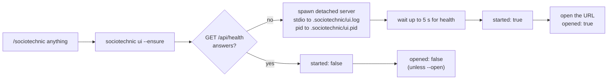
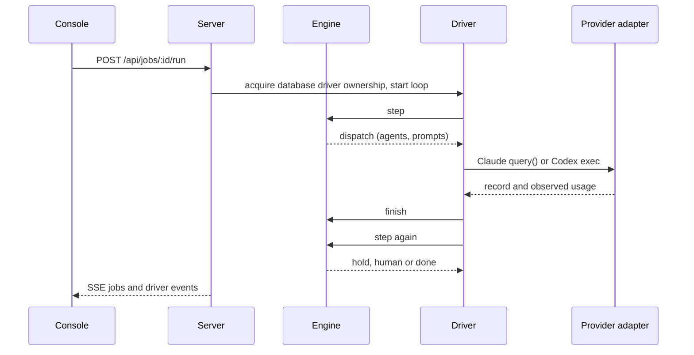
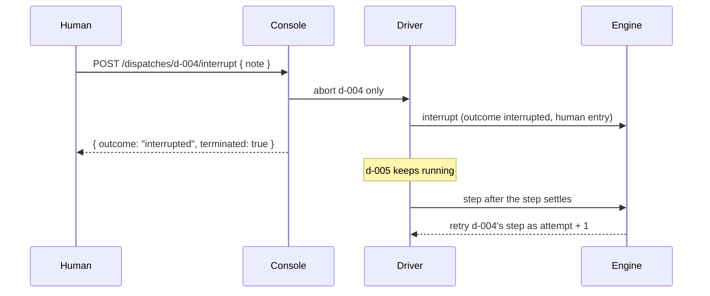

# CLI and driver reference

[App guide](../../README.md) · [Engine and state reference](engine-reference.md) · [Development](development.md)

Command examples assume this repository root unless a different directory is named. For browser use, start with the [app guide](../../README.md).

## Optional Docker Sandbox runs

`new` accepts `--execution docker-sandbox`, `--cpus <1..32>`,
`--memory-gib <1..64>` and `--parallel-agents <1..4>`. Omitted execution stays
local; resource flags require Docker execution. The selected setting is pinned
for the run. New run exposes the same choice. See [setup, the v3 recipe, storage
and recovery](docker-sandboxes.md), including the required host Context7 gateway
registration. Drivers must not execute these jobs' agents or target checks
directly on the host. Ordinary local merges and publishing
still follow the existing human decisions.

## Getting started

### Prerequisites

- Node 24 or newer. Node runs the engine’s `.ts` sources directly; the React console has a separate build. `task install` installs both workspace packages. See [Development](development.md#development).
- [pnpm](https://pnpm.io) 12. `sociotechnic/package.json` pins `packageManager`, so pnpm manages its own version. There is no corepack step. Dependencies install under the [supply chain policy](development.md#supply-chain-policy).
- [go-task](https://taskfile.dev). The root `Taskfile.yml` is the entry point; `task` with no argument lists the tasks.
- git.
- Claude Code configured to run agents, plus Codex CLI logged in with ChatGPT for
  Sol code review and Luna research. See [Codex setup](codex-integration.md). For the project skill, open a session in this repository root so `.claude/skills/sociotechnic/` loads; the console resolves pinned agents from PostgreSQL. You can also start runs from the console or install the [global command](#global-command).
- A target git repository to change. It can be any repository on disk.
- Required for job workflows: PostgreSQL 17 on `localhost:5433`, or another connection configured through `SOCIOTECHNIC_DATABASE_URL`. Jobs, records and agent releases have no file fallback. `SOCIOTECHNIC_DATABASE_URL=off` disables job operations; pure utilities and bundled-agent validation remain available.

### 1. Set up (once)

Install the dependencies from the root of this repository. This runs `pnpm install --frozen-lockfile` in `sociotechnic/`.

```bash
task install
```

Run the engine and console type checks, console build, agent validation, tests and dependency audit.

```bash
task checks
```

Create the state-store database (optional, see [State store](engine-reference.md#state-store)).

```bash
task db:init
```

### 2. Initialize the target repo (optional)

```bash
sociotechnic/bin/sociotechnic init /path/to/target-repo
```

This writes a starter `.sociotechnic.json` at the target root with your detected checks. It refuses to overwrite an existing file. Without a `.sociotechnic.json`, defaults apply and the gate flags `no-checks-configured`, which parks the job for a human.

### 3. Start a job

To build and open the background console:

```bash
task ui
```

Choose **New run**, enter the target repository and change, then start planning. The React console holds at `planned`; read the plan and choose Continue to build. See [Run console](#run-console) for development mode and driver details.


For the project skill, use the commands below. The [global skill](#global-command) differs: `new` starts planning immediately with a hold, and `continue` hands the build to the console.

In the Claude Code session:

```text
/sociotechnic new /path/to/target-repo add a login page
```

The engine commits the job to PostgreSQL, creates a branch `sociotechnic/<job-id>` cut from the repo's base branch, and creates a Git worktree under `.sociotechnic/worktrees/<job-id>/`. Agent files are temporary dispatch staging under `.sociotechnic/staging/`. The session reports `job`, `branch` and `worktree`. Pass `--base <branch>` through the engine command to branch from something other than the current base.

Job ids look like `20261023-add-a-login-page`: the date, then the feature text slugged to 24 characters, with `-2`, `-3` on collisions.

### 4. Run it

```text
/sociotechnic run 20261023-add-a-login-page
```

The session hands execution to the console driver and returns its state and URL. The driver continues until the engine says `hold`, `human` or `done`. The session does not relay record prose or findings. Read committed record detail in the console; staging is not the record store.

### 5. At `ready`, `needs-human`, `merged-local` or `accepted`

The standard order is: merge locally, test in your own checkout, accept, then publish.

| Status | Meaning | You can |
| --- | --- | --- |
| `ready` | The approver approved at the current commit. `merge` brings the branch into your checkout so you can test it where you work | `merge` (local), `accept`, `rework`, `pr` (local text), `stop` |
| `merged-local` | The branch is merged into the base branch of your checkout. The worktree and job branch are kept. Test it there | `accept`, `rework`, `pr` (local text), `stop` |
| `accepted` | You tested and accepted the change. Shows the pull request link once `pr --push` has recorded one | `pr --push`, `merge --remote --confirm`, `merge` (finish locally), `pr`, `stop` |
| `needs-human` | Parked with a reason: a loop bound, a gate flag, an ESCALATE, a BLOCKED build, or a retry bound | `merge` (local), `accept`, `rework`, `override` then `run`, `stop` |
| `stopped` | You stopped the job. `job.json` records `stoppedFrom`, the status it left | `reopen` (Reopen), `reopen --discard` (Reopen and discard changes), `clean` |

```text
/sociotechnic merge 20261023-add-a-login-page
# test the change in your checkout
/sociotechnic accept 20261023-add-a-login-page works in the app
/sociotechnic pr 20261023-add-a-login-page --push
/sociotechnic merge 20261023-add-a-login-page --remote --confirm

/sociotechnic rework 20261023-add-a-login-page the empty state is missing
/sociotechnic override 20261023-add-a-login-page rounds one more pass is fine
/sociotechnic pr 20261023-add-a-login-page
```

- `merge` from `ready` or `needs-human` is local. Your checkout must have a clean tree and be on the base branch. Sociotechnic runs `git merge --no-ff` there, records `localMerge` in `job.json` and moves the job to `merged-local`. The worktree and job branch are kept so `rework` and `pr --push` still work. Nothing is pushed.
- `accept` moves the job to `accepted`. It is your signature that you tested the change: in your checkout after a local merge, or in the worktree if you skipped the merge.
- Before a plan exists, `rework` at a `retry-bound:plan` hold records planner feedback, grants one `retriesPerStep` override and returns to planning (`round: 0`). The console retries with a `planned` hold. A pinned plan is not changed this way.
- After a build round exists, `rework` writes your note as a `[high]` finding in `round-N/review-human.md`, grants one `rounds` override and opens the next round on the next `run`. After a local merge, the next `merge` from `ready` brings only the new commits.
- `override` raises one loop bound by one and resumes the job where it parked on the next `run`.
- `pr` generates `pr.md` from the records. It never touches a remote.
- `pr --push` runs only from `accepted`, only when you type `--push`. It pushes the job branch and opens the pull request with `gh`.
- `merge` from `accepted` finishes the job locally: it merges when the job head is not already in the base branch, then removes the worktree, deletes the job branch and sets `merged`.

Agents commit and nothing more. Publishing and remote merging require human acceptance and an explicit human command. `pr --push` publishes from `accepted`; `merge --remote --confirm` merges the published PR from `accepted` or from a job already finished locally. Plain `merge` stays local.

A local merge and a GitHub merge can produce different histories, especially with squash or rebase. After a remote merge, fetch and inspect your local base branch before choosing how to synchronize it. Sociotechnic preserves that checkout and never pushes the base branch.

### Publishing after accept

`/sociotechnic pr <job> --push` (engine: `pr <job> --push`) publishes an accepted job. Spec: [CONTRACTS.md section 18](../CONTRACTS.md).

1. Generate `pr.md` as `pr` does. Its footer ends with the line `🤖 Generated with [Claude Code](https://claude.com/claude-code)`.
2. Require the target repo's `origin` to be a GitHub remote and `gh` to be on PATH and authenticated. Otherwise exit 1 with `no-github-remote` or `gh-unavailable`, and nothing is pushed.
3. Run `git push -u origin sociotechnic/<id>` from the worktree. A missing worktree is recreated from the branch first, as `restore` does.
4. Run `gh pr create --base <base.branch> --head sociotechnic/<id> --title <plan.title> --body-file <pr.md>`. Before creating a PR, Sociotechnic lists open pull requests for the job branch with `gh pr list --head <branch> --json url,number --state open` and reuses a match.
5. Record the result in `job.json` and return `{ record: "pr.md", title, pushed: true, url, number }`.

The record is `pr: { url, number, pushedAt, head }`, where `head` is the pushed commit sha. The engine also appends a `human` entry `{ action: "pr-push", note: <url> }` to the job history and commits the job. The status stays `accepted`.

Choose **Merge PR on GitHub** in the console and confirm the PR URL, published
commit, target branch and merge method. From the CLI or `/sociotechnic` skill:

```bash
sociotechnic/bin/sociotechnic merge <job> --remote --confirm
# Optional: --method squash or --method rebase; default is merge.
```

This also works after a local merge, including one finished from `accepted` that removed the worktree and branch.
GitHub must still have the recorded PR at the published head; changed heads,
draft/closed PRs and blocked merges are refused. The head SHA is included in
the merge request, so a concurrent push cannot silently change the merge.
GitHub's checks, reviews and branch rules govern the result. Sociotechnic does not
enable auto-merge or bypass requirements; use GitHub for repositories requiring
a merge queue.

Confirmed success records the remote commit in `pr.merge` and a `merge-remote`
human event. An interrupted request can be retried to reconcile an already
merged PR. Local checkouts and worktrees stay as they are; synchronize the local
base separately. Plain `merge <job>` continues to perform the local merge.

In the React console, the `ready` panel offers Merge locally first (behind a confirm that names your checkout), then Accept, Request rework and Stop run. The `merged-local` panel says the change is merged into your checkout to test there and offers Accept, Request rework and Stop run. The `accepted` panel offers Push and open PR (behind a confirm that names the branch and base), Finish locally (or Merge locally when no local merge is recorded, behind a confirm) and Stop run, then Merge PR on GitHub and the pull request link once `pr` is recorded. Choose Prepare PR text in the React command palette (also beside Push and open PR after acceptance). Generate `pr.md` without pushing with `pr <job>`, `POST /api/jobs/:id/pr` with `{ "push": false }`, or Generate PR text in `/legacy`, which offers it in the `ready`, `merged-local`, `accepted` and `merged` panels. The skill pushes only when you typed `--push`, never on the suggestion of an agent or a record.

## Run console

A local web page that shows what a run is doing and lets you start, hold, resume and gate runs. The project and global `/sociotechnic` skills also hand runs to this shared driver. It routes each pinned dispatch to Claude Agent SDK or the subscription-authenticated Codex CLI and obeys the same engine.

```bash
sociotechnic/bin/sociotechnic ui
```

The server prints one JSON line `{ url, port, pid, sociotechnicHome }`, opens the URL in your browser and runs in the foreground until SIGINT or SIGTERM. Run `task build` first for the React console, or `task ui` to build and ensure a background server. Before a build exists, the server uses the original HTML console.

The React console uses an inbox sidebar, decision bar, four summary cards, recorded token chart and Dispatches/Records/Log/Decisions tabs. Evidence opens in right-hand sheets; the round selector preserves earlier evidence. Controls offers Pause, Step once, hold after a transition and early bound overrides. Step once uses `POST /api/jobs/:id/run` with `{ "mode": "step" }`, which executes one engine instruction; raw `/step` only returns an engine envelope. Settings manages local concurrency, sandbox capacity, theme and browser-owned defaults for new-run holds. History and Agents are sidebar destinations; Run history and Run agents enter their run-scoped views. The command palette lists legal actions with CLI equivalents. Records support formatted/raw reading and original-byte download, and dispatch details support interrupt with a note.

Both consoles offer Recover worktree and continue when a runnable run's worktree is missing; `/resume` restores and starts the driver. The React console also offers Restore worktree in Controls and Commands for eligible missing-worktree cases. It calls the dedicated `/restore` operation without starting a driver or changing the run's human gate.
For frontend development, `task dev` first stops TCP listeners on ports 5173 and 4748, allowing five seconds for graceful shutdown before force-stopping any remaining listeners. It then starts a separate API at port 4748 and Vite at `http://127.0.0.1:5173`, opening the page when ready. Vite refuses to switch ports. It proxies `/api`, `/events` and `/legacy` to that API. Ctrl-C stops both processes. The production server on 4747 can keep running. Cleanup requires `lsof`.

To see the live logs of an already-running console without restarting its driver,
use `SOCIOTECHNIC_API_URL=http://127.0.0.1:4747 task dev`. This clears only port 5173, starts only Vite and leaves
that existing API running when development stops.

For Impeccable live editing against the Node server, `NODE_ENV=development sociotechnic/bin/sociotechnic ui` permits the picker at `http://localhost:8400` in script and connection CSP directives. Default and production CSP remain self-only.

`--port <n>` sets the port (default 4747; `--port 0` picks a free one). `--no-open` skips opening the browser.

Each round shows the build commit, configured checks and review verdicts. Findings expand in place; unmatched lenses read SKIPPED.

The Checks milestone also recognizes verification already documented in the
current build record. With no configured repository checks, it shows **Evidence
recorded** and opens that record. Overview and the current round in Analysis
label this as **Builder-reported verification**, showing checked and unchecked
acceptance counts. Engine check results and the `no-checks-configured` human
flag remain separate. No command or HTTP route changes are required.


Analysis reports recorded tokens with uncached input, output, cache read and cache write, plus dispatch counts and median durations. Missing measurements stay unreported. SDK dollar estimates in historical records are not a statement of subscription billing.


### Keeping the console up

You rarely start the console by hand. Every `/sociotechnic` command begins with `ui --ensure`. It opens the browser when it starts a server; use `/sociotechnic ui` to open an already-running console. The console lists jobs in its configured PostgreSQL database across target repositories; missing local staging does not hide history. `/sociotechnic` with no arguments is the overview: ensure the console, then `jobs` grouped by project.



| Command | Does | Output |
| --- | --- | --- |
| `ui --ensure [--port <n>] [--open] [--no-open]` | Makes the console available without blocking. When `/api/health` on the port already answers it returns at once. Otherwise it spawns the server detached (`node <cli> ui --port <n> --no-open`) and waits up to 15 s for health after catalog initialization. It opens the URL only when it just started the server or when `--open` is given, never with `--no-open`, so a run never spawns a browser tab per command. `task ui` runs it | `{ url, port, pid, sociotechnicHome, running, started, opened }` |
| `ui --stop [--port <n>]` | Sends SIGTERM to the pid that `/api/health` reports (or the pid file) and waits up to 5 s. `task ui:stop` runs it | `{ stopped, pid }` |

Two files in `.sociotechnic/` belong to the daemon.

| File | Holds |
| --- | --- |
| `.sociotechnic/ui.pid` | The pid of the detached server |
| `.sociotechnic/ui.log` | The server's stdout and stderr. Read it when the console does not come up |

`GET /api/health` returns `{ ok, sociotechnicHome, pid, startedAt }`. `--ensure` and `--stop` use it to find a running console.

### Run visibility

The jobs endpoint always includes archived runs, marked by `archived: true`.
The React rail hides them until Show archived is checked. Archive/Restore commits
visibility state in the database job document without changing workflow status or
records. It survives staging loss and database backup/restore. A selected
run stays open when archived, and a running driver continues. Desktop run lists
scroll independently from the detail pane, with the rail filters fixed above.

### What the React console shows

| Surface | Content |
| --- | --- |
| Decision bar and evidence sheets | Current human decision, plan, checks, reviews, gate blockers, approval and diff; round selection and original request/worktree detail |
| Summary cards and chart | Cumulative agent time, reported tokens and estimated cost, moment evidence; completion-step usage by dispatch with cache-read subset overlay |
| Dispatches | Role/status, model/effort, tokens, elapsed, record and details; column customization and filtered visible-column CSV download |
| Records | Name, kind, attribution, timestamp, size and original-byte download; formatted/raw sheets |
| Log and Decisions | Buffered driver log with dispatch filter and SSE catch-up; human actions and notes |
| History | Run/project/archive filters, completion-day cost reports, tokens by role/round, separate outcomes and feedback, paged exact source evidence |
| Agents | Global search and comparisons; In run uses pinned assignments, releases, tools and budgets; metric/category/cohort counts open contributing deployments |
| Settings | Local dispatch limit, sandbox capacity, theme and saved new-run holds in this browser |

Record and dispatch selections use hash parameters `job`, `dispatch` and
`record`; they survive navigation from History or Agents and a reload. Agent
filters use `agentRun`, `agentMetric`, `agentCategory` and `agentCohort` alongside
search, sort and page. History uses `historyJob`, `historyProject`, `historyRole`,
`historyRound`, `historyDay`, `historyArchive`, `historyMetric`, `historyCategory`
and `historyPage`. Missing or superseded evidence is never silently replaced
with the latest attempt's record.

### Legacy console

`/legacy` retains the original HTML console, including Recover worktree and continue, single-step controls, Generate PR text, Reopen and discard changes, a database status dot and a help drawer showing [the driver contract](../AGENTS.md). Its header summarizes projects, jobs and running drivers. Jobs with pending session dispatches also count as running.

### Starting a run

For UI verification with a browser-enabled builder release, prepare local tools
with `task browser:install`; Docker build dispatches prepare them in their own
VM. See [browser tooling, isolation and smoke checks](browser-verification.md).
These CLIs do not alter Sociotechnic's acceptance or publishing commands.

The React console remembers the chosen run environment and last valid sandbox
CPU, memory and parallel-agent settings across sessions on the same browser and
console origin. Edits save automatically, including when canceling the dialog.
Switching to Local keeps sandbox resources for later. Invalid resource drafts
do not replace saved resources; missing or malformed preferences restore Local
and 4 CPUs, 8 GiB and 2 agents. Storage failures show a nonblocking status.
These form preferences do not change existing runs, CLI/API defaults or the
installation-wide sandbox slot limit.

Settings saves new-run hold defaults in `localStorage` under
`sociotechnic.new-run-holds.v1`. Allowed transitions are `planned`, `built`,
`checked` and `reviewed`; the console always includes initial `planned` review.
New run reads those defaults when opened and submits them as `consoleHolds`.
The job persists that optional array in PostgreSQL. Continue uses its pinned
holds, omitting the current status so an explicit continuation advances. A
one-run Controls hold overrides the defaults only for that start. Existing jobs
without `consoleHolds` retain their previous behavior; CLI/global defaults and
running jobs are unchanged. Invalid or unavailable browser storage falls back
to plan review with a local message. A failed save preserves the previous stored
value and reports failure.

The **New run** form takes a repository path, an optional base branch and a multi-line prompt. Start creates the job and runs it. The React console always holds at `planned` so you can read `plan.json` before any build; the legacy console also offers a hold toggle. Press Continue to build. A plan is never edited in place. To change it, stop the job and start a new one with a better prompt.

In the React console, **Browse** opens an inline folder browser on the server's
computer. It starts at `~/Prog` if accessible, otherwise the user's home. Enter a
location and choose **Go** to remember that start point in this browser across
sessions on the same console origin. Clicking child/parent folders does not
replace it. An unavailable saved path falls back to home; an invalid Go path
shows an error and keeps the previous preference. Browser storage failures are
visible but do not prevent browsing. **New folder** creates one child and opens
it; **Use this folder** selects it. Browsing alone does not modify files.
**New repository** is a UI preset for feature planning that requires Git
initialization and publishes the base branch before starting the run. Its GitHub
repository field defaults to the folder name; enter `owner/repository` to choose
another owner. Start creates a private GitHub repository, connects `origin` and
pushes only the selected base branch. GitHub authentication, creation or push
errors leave local files intact and prevent the run from starting. A failed push
can be retried using the same destination and matching origin; a different origin
or an existing remote base at another commit is refused. The normal acceptance
and PR gates still apply to the run's changes. It uses the same job route without
a new engine workflow.
**Initialize Git if needed** is enabled
by default: Start initializes an existing directory outside Git on the supplied
base branch (default `main`), adds missing `readme.md` (`tbd\n`) and `.gitignore`
starter files, and commits only those files. Existing starter contents and README
casing are preserved. Committed repositories, including selected subdirectories,
are unchanged. Unrelated files stay untracked; they will not appear in the run's
worktree. Fix Git identity or hook errors and retry if the initial commit fails.

HTTP clients use `POST /api/repositories/browse` with
`{ path?: string, fallback?: boolean }` for `{ path, parent, directories }`.
`fallback: true` uses home if a supplied path cannot be browsed; otherwise invalid
paths fail. `POST /api/repositories/create` takes `{ path, name }`, creates one
child without Git setup, and returns its listing. Dot entries, `.git`, separators,
control characters and existing entries are refused. `POST /api/jobs` with
`initialize: true` opts into local Git setup. Adding `githubRepository: "name"`
or `"owner/name"` explicitly creates the private remote and publishes the base
before job creation; this requires `initialize: true` and ordinary feature planning.
A name without an owner uses the authenticated GitHub account. Setup requires
authenticated `gh` and a repository root, not a selected subdirectory. Existing
remote bases must match the selected local commit. No force push is used.
All use the existing JSON and same-origin
protections. The CLI and
legacy console continue to require an existing committed repository.

### How it drives agents

The console routes each dispatch by its recorded model. Claude dispatches use
`query()` with project definitions, hooks and role limits. Code review uses
`gpt-6.1-sol/high` and research uses `gpt-6-luna/high` through local Codex CLI and
saved ChatGPT login. Codex readers receive read-only MCP tools with no shell
or arbitrary writes. Ordinary Codex builders can edit and run commands in the
assigned worktree, with the same checks, record ingestion and human gates. Network access follows pinned template tools: planner and
research have web search and configured Context7, security review has web search,
and other readers have neither. Ordinary builder network access also follows
the pinned tools. Compatible reader and ordinary builder releases can switch provider
through Add agent or Manage versions.
It publishes the successful final response to the assigned record and returns
observed tokens and duration to `finish`. It never falls back to another provider
or API-key billing. Historical dispatch bindings remain valid. See
[Codex setup and verification](codex-integration.md) and
[network access](engine-reference.md#network-and-docs-access).




### Safety and handoff

- The server binds `127.0.0.1` only and has no authentication. Anyone on the machine can reach it.
- It refuses a request whose `Host` is not its own address (DNS rebinding), and a mutating request with a foreign `Origin` or without `Content-Type: application/json`. `finish` is not exposed, and the console never edits a record, `job.json` or the plan.
- `stop <job> [note...]` and `POST /api/jobs/:id/stop` with `{ "note": "..." }` keep the optional note verbatim in the run's human decision history. Omitting it keeps an empty note. A non-string HTTP note is rejected before stopping the driver or changing the run. The stop reason and aborted dispatch notes stay "stopped by human".
- Only one driver may run a job at a time. PostgreSQL holds driver ownership through a session advisory lock and a stored owner record (`host`, `pid`, `token`, `startedAt`, `mode`, `owner` of `ui` or `cli`). `step` from elsewhere is refused while that owner holds the job; interrupted ownership must be reconciled before takeover. Connection loss aborts execution and rejects stale completions. Local lock files cannot grant ownership. Pause the driver or wait for a gate; handoff remains available there.

UI owners also record `consoleUrl`. The jobs, job-detail and driver endpoints
include `driver.ownership`: `local`, `none`, `interrupted`, or `external`. External
ownership includes `owner` (`ui`, `cli`, or `unknown`) and a safe same-host
loopback `url` selecting the job, or `null` when no location is known. It reports
`running: true` to block duplicate local execution; this describes ownership,
not an independently verified agent heartbeat. The React console replaces local
run controls with Open owning console and Refresh status. A dead same-host owner
is reported as interrupted so Continue can use existing recovery checks.
Ownership claim/release changes notify all connected consoles; the selected
external owner also refreshes every five seconds to detect an exited process.
For older UI owners without a URL, discovery checks only ports 4747 and 4748,
requiring both the health PID and active-driver start time to match. Other hosts,
CLI owners and unverified locations never receive a guessed link.

### Interrupting one dispatch

Stop ends every agent in a run. To end one agent and keep the run in place,
interrupt that dispatch:

```bash
sociotechnic/bin/sociotechnic interrupt 20261025-add-login d-004 'Ask about src/ only'
```



- The dispatch is recorded `outcome: "interrupted"` with your trimmed note, and the job history gains `{ action: "interrupt", note: "d-004: Ask about src/ only" }`.
- Other dispatches of the same step keep running. When they finish, the next `step` retries the interrupted step as `attempt + 1` with `interrupted by human: <note>` as the retry reason in the new brief, so the note steers the retry.
- That retry counts against `retriesPerStep` and `dispatchesPerRound`, as a dispatch a stop aborted does. Past the retry bound the job parks at `retry-bound:<step>`. Run `override <job> retriesPerStep <note>` first, in any non-terminal status, to keep a further attempt.
- Pause first if the run should stop before that retry instead of continuing.
- A dispatch queued for a local slot is recorded without ever launching (`terminated: false`).
- Interrupt refuses a finished or unknown dispatch (409 or 404), another console's run (409 `driver-active`; use its console), and Docker Sandbox runs (409 `sandbox-interrupt`), whose dispatches share one sandbox; stop those instead. A design conversation keeps its own interrupt route.

### Local concurrency limit

By default every dispatch of a step starts at once. To cap how many local
dispatches one console runs at a time across its jobs:

```bash
curl -s http://127.0.0.1:4747/api/local/capacity
# {"limit":null,"configurable":true,"running":0,"queued":0}
curl -s -X POST -H 'content-type: application/json' \
  -d '{"limit":2,"expectedLimit":null}' http://127.0.0.1:4747/api/local/capacity
# {"limit":2}
```

The limit is stored in `.sociotechnic/local-settings.json`; send `limit: null` to
remove it. `expectedLimit` must match the current value (409
`stale-local-capacity` otherwise). `SOCIOTECHNIC_LOCAL_MAX_DISPATCHES` fixes the
limit and makes the route refuse changes (409 `local-capacity-managed`). Extra
dispatches wait in start order, appear in the driver's `queued` list, and see a
changed limit within a second. Waiting counts against each dispatch's deadline:
one whose deadline passes in the queue is recorded `timeout` without launching.
Docker Sandbox runs keep their per-run parallel-agent slots instead.

### Driver log streaming

Every driver line is sent on `/events` as it is written:

```text
event: log
data: {"jobId":"20261025-add-login","dispatchId":"d-004","seq":42,"at":"2026-10-25T15:04:05.000Z","level":"info","line":"d-004 sociotechnic-researcher -> Read src/app.ts"}
```

`seq` increases by one per line for each job in this console process.
`dispatchId` is null for driver lines and the session id for design
conversation lines. The console keeps each job's newest lines within 1 MiB
(each line at most 8 KiB). Catch up with
`GET /api/jobs/:id/log?after=<seq>&limit=<n>`, which returns the entries after
`after` plus `first`, `last` and `more`; when `after + 1` is below `first`, the
buffer has dropped lines you did not see. The driver state still carries the
newest 200 lines, and the existing `jobs` and `driver` events are unchanged. A
restarted console starts a new buffer at `seq` 1.

## Global command

`/sociotechnic` can work in every Claude Code session on the machine, whatever the directory, not only in a session opened here. The global skill opens the run console and hands runs to the console's shared provider driver. Spec: [CONTRACTS.md section 15](../CONTRACTS.md).

### Two skills

| Skill | Where it loads | How it drives a job |
| --- | --- | --- |
| Project skill, `.claude/skills/sociotechnic/` | Sessions opened in `SOCIOTECHNIC_HOME` | Hands execution to the shared console driver |
| Global skill, `~/.claude/skills/sociotechnic` | Every other session | It never spawns agents. It tells the console's driver to run the job |

- The `sociotechnic-*` role definitions are project-local to `SOCIOTECHNIC_HOME`. The console loads Claude definitions through the SDK and reuses the pinned prompt bodies for Codex. It honors each provider's execution limits.
- In `SOCIOTECHNIC_HOME` itself the project skill takes precedence.
- The driver lock keeps the two from driving one job at once (see [Safety and handoff](#safety-and-handoff)).
- The global skill never uses the Agent tool, never calls `step` or `finish`, and never edits a record.

### Install

```bash
task install:global
```

This runs `mkdir -p ~/.claude/skills` and `ln -sfn <repo>/sociotechnic/global ~/.claude/skills/sociotechnic`, then lists the link. Nothing is copied, so edits to `sociotechnic/global/` are live. The symlink is the only thing sociotechnic ever places under `~/.claude`. To remove the global command, delete that symlink.

### The shim

`sociotechnic/global/sociotechnic` is a POSIX shell shim. The skill runs every engine command through `~/.claude/skills/sociotechnic/sociotechnic <command>`.

1. If `SOCIOTECHNIC_HOME` is set in the environment, it is used as is.
2. Otherwise the shim follows its own symlink to its real path and takes the directory two levels above `sociotechnic/global/`, which is the repository root. If `readlink -f` is unavailable it falls back to the path it was called by.
3. It exports `SOCIOTECHNIC_HOME` and execs `$SOCIOTECHNIC_HOME/sociotechnic/bin/sociotechnic` with the same arguments.

It prints exactly what the engine prints: one JSON object. Exit 1 prints `{ "error", "code" }`. The skill reports an error in one sentence and stops.

### The `/sociotechnic` overview

Every `/sociotechnic` command starts with `ui --ensure`; an existing server is reused without opening another tab. The skill says "console is open at `<url>`" the first time in a conversation and nothing afterwards. `/sociotechnic` alone lists jobs grouped by project, then offers a new workflow or resuming a job.

- When the current directory is inside a git repository, the skill names that repository as the default for a new workflow.
- Resume fits a job that is `planned` or `needs-human`; missing staging does not change job availability. A `ready` job wants `merge` (local), `accept` or `pr`; a `merged-local` job wants `accept`; an `accepted` job wants `pr --push` or `merge` instead.

### Holds and `continue`

`/sociotechnic new` creates the job, then calls `run <job> --hold planned`. The driver stops at `planned` so you can read `plan.json` in the console before any build. `/sociotechnic continue <job>` calls `run <job>` with no hold and builds. A hold is passed only on `new`, or when you ask to review a plan before building.

### Global command differences

Most commands have the same meaning as in the [session command reference](#session-commands). These global commands hand execution to the console:

| You type | Global behavior |
| --- | --- |
| `/sociotechnic new [repo] <feature...>` | Creates the job and runs with `--hold planned`; the repository defaults to the current directory's git repo |
| `/sociotechnic continue <job>` | Starts the console driver without a hold |
| `/sociotechnic resume <job>` | Recovers a missing Git worktree when possible, then starts the console driver |
| `/sociotechnic pause <job>` | Stops the console driver after in-flight dispatches |
| `/sociotechnic reopen <job> [--discard]` | Reopens, then starts the console driver; discard only when explicitly requested |
| `/sociotechnic rework <job> <note>` | Records feedback, then starts the console driver |
| `/sociotechnic override <job> <bound> <note>` | Raises the bound, then starts the console driver |
| `/sociotechnic init [repo]` | Writes starter configuration; defaults to the current repository |

The global skill never calls `step` or `finish`, spawns agents itself, or passes `--force`. It uses the same explicit human commands for publishing and merging. See [Engine-only commands](#engine-only-commands) for `run` and `pause`.

## Commands

Engine commands run as `sociotechnic/bin/sociotechnic <command> [args]`. Commands return one JSON object on stdout; foreground `ui` prints its startup object and remains running. Exit 0 is success. Exit 1 prints `{ "error": "...", "code": "..." }`. Job and catalog operations require PostgreSQL. A failed database read or commit fails the command; there is no warning-only success or file fallback. A disabled store cannot run jobs. `db status` remains a diagnostic command that may report `reachable: false`.

### Session commands

| You type | Engine command | Result |
| --- | --- | --- |
| `/sociotechnic init <repo>` | `init <repo>` | `{ path, checks }` |
| `/sociotechnic new <repo> <feature>` | `new <repo> <feature...> [--base <branch>]` | `{ job, source: "db", worktree, branch, base }` |
| `/sociotechnic run <job>` | `run <job>` | returns driver state and URL; the driver continues until `hold`, `human` or `done` |
| `/sociotechnic step <job>` | `run <job> --step` (optional `--hold <status,...>`) | driver state and URL; one engine step |
| `/sociotechnic` (no arguments) | `ui --ensure`, then `jobs` grouped by project | the overview |
| `/sociotechnic ui` | `ui --ensure --open` | `{ url, port, pid, sociotechnicHome, running, started, opened }` |
| `/sociotechnic status [job]` | `status [<job>]` | `{ job, status, statusReason, round, pending, overdue, nextAction }` or `{ jobs: [...] }`. With no job it lists database jobs; missing staging does not change the result |
| `/sociotechnic override <job> <bound> <note>` | `override <job> <bound> <note...>` | `{ job, bound, effective }` |
| `/sociotechnic rework <job> <note>` | `rework <job> <note...>` | `{ job, round }` |
| `/sociotechnic accept <job> [note]` | `accept <job> [note...]` | `{ job, status }` |
| `/sociotechnic pr <job>` | `pr <job>` | `{ record: "pr.md", title, pushed: false }` |
| `/sociotechnic pr <job> --push` | `pr <job> --push` | `{ record: "pr.md", title, pushed: true, url, number }`. From `accepted` only. Errors: `illegal-transition` before accept, `no-github-remote`, `gh-unavailable`, `no-branch` |
| `/sociotechnic merge <job>` | `merge <job>` | `{ job, status, mergeCommit, merged, warnings? }` |
| `/sociotechnic merge <job> --remote --confirm [--method merge\|squash\|rebase]` | `merge <job> --remote --confirm [--method merge\|squash\|rebase]` | `{ job, remote: true, url, mergeCommit, alreadyMerged }`; local checkout preserved |
| `/sociotechnic stop <job>` | `stop <job> [note...]` | `{ job, status }` |
| `/sociotechnic reopen <job>` | `reopen <job> [--discard]` | `{ job, status, worktree, changes, files }` |
| `/sociotechnic usage <job>` | `usage <job>` | `{ roles: [{ role, model, effort, dispatches, usage }] }` |
| `/sociotechnic continue <job>` | `run <job>` | `{ job, status, url, restored, driver }`. Global skill only: the console drives |
| `/sociotechnic pause <job>` | `pause <job>` | `{ job, driver }`. Global skill only: stops the console's driver |

`/sociotechnic continue` and `/sociotechnic pause` exist in the global skill (see [Global command](#global-command)). The project skill also uses `run` for execution and can use `pause` to park the shared driver.

`<bound>` is one of `rounds`, `dispatchesPerRound`, `retriesPerStep`.

`--hold planned` on `step` stops the engine at `planned` and returns `action: hold`, so you can read the plan before a build. The next `step` without it continues. Driver ownership remains enforced; do not force past an active or interrupted owner. Every `/sociotechnic` command starts with `ui --ensure`, so the console is already on screen when the command runs. `/sociotechnic ui` is that step on its own.

### Engine-only commands

| Command | Does | Result |
| --- | --- | --- |
| `inventory <repo> --scope <path> [--base <ref>]` | Read tracked source at a commit; locate supported comments, report exclusions/manual files and create bounded packets | Git-bound inventory JSON |
| `verify-comments <repo> --base <sha> [--head <ref>]` | Compare supported files' ASTs, literals and protected directives | `{ blockers, flags }` |
| `new <repo> [goal] --workflow comments --scope <path> [--base <branch>]` | Generate and pin a COMMENTS plan without a planner; returns held at planned | `NewResult & { status: "planned" }` |
| `finish <job> <dispatch-id> [--outcome ok\|failed\|timeout] [--usage <json>] [--note <text>]` | Marks a dispatch finished and parses its record. The driver calls it. Do not call it twice for one dispatch. It refuses `interrupted`, which only `interrupt` records | `{ dispatch, outcome, parsed }` |
| `interrupt <job> <dispatch-id> [note...] [--port <n>]` | Ends one unfinished dispatch as `interrupted` with your note. When a console driver owns the job, the CLI sends the request to that console (its recorded URL, or `--port`), which aborts only that agent while the rest of the step continues. With no driver, it records the dispatch directly. See [Interrupting one dispatch](#interrupting-one-dispatch) | `{ job, dispatch, outcome: "interrupted", note, terminated }` |
| `verdict <file> --role <role>` | Parses one record file with a role's contract. Debug aid. | the parsed record |
| `agents` | Validates bundled initialization seeds against `roles.ts` | `{ ok, problems: [] }` |
| `reopen <job> [--discard]` | From `stopped` only: back to `stoppedFrom`. See [Reopening a stopped job](engine-reference.md#reopening-a-stopped-job) | `{ job, status, worktree: "present" \| "restored", changes: "kept" \| "discarded" \| "none", files: [...] }` |
| `pr <job> [--push]` | Same command as the session row. Without `--push`: from `ready`, `needs-human`, `merged-local`, `accepted` or `merged`, writes `pr.md`. With `--push`: from `accepted` only, pushes the branch and opens or reuses the pull request. See [Publishing after accept](#publishing-after-accept) | `{ record: "pr.md", title, pushed: false }` or `{ record: "pr.md", title, pushed: true, url, number }` |
| `clean <job>` | From `merged` or `stopped`: removes the worktree if present | `{ job, removed }` |
| `usage <job>` | Per-role totals from recorded dispatch usage | see above |
| `ui [--port <n>] [--no-open]` | Starts the run console on `127.0.0.1`. Default port 4747, `--port 0` for a free one. Foreground until SIGINT or SIGTERM | `{ url, port, pid, sociotechnicHome }` |
| `ui --ensure [--port <n>] [--open] [--no-open]` | Starts the console as a detached background daemon if it is not already answering, and opens it when it just started it or when `--open` is given. See [Keeping the console up](#keeping-the-console-up) | `{ url, port, pid, running: true, started }` |
| `ui --stop [--port <n>]` | Stops the background console | `{ stopped, pid }` |
| `db init` | Creates the `sociotechnic` database if missing and applies the schema. Idempotent | see [State store](engine-reference.md#db-commands) |
| `db status` | Reports the connection and row counts | `{ url, reachable, version, jobs, records, events }` |
| `db import-jobs --dry-run --out <manifest> [--prefer-local]` | Inventory legacy jobs and database records, reporting source hashes and conflicts | see [State store](engine-reference.md#db-commands) |
| `db import-jobs --apply --manifest <file>` | Apply the reviewed source-bound maintenance import; reject unresolved conflicts | import result; no runtime fallback |
| `db catalog-export --out <new-bundle.json>` | Export every immutable agent release, including older and unused versions | export result |
| `db catalog-check` | Compare the complete database catalog against the union of committed migration bundles | coverage; fail when releases are missing or conflict |
| `db backfill-agent-versions --before <UTC timestamp> [--confirm]` | Preview operator-confirmed v1.0.0 attribution for completed unversioned dispatches through the cutoff; `--confirm` applies it to canonical database history | `{ applied, before, version, dispatches, jobs }` |
| `jobs [--project <name\|path>] [--status <s>] [--limit <n>]` | Lists canonical database jobs | `{ source: "db", jobs: [...] }`; worktree availability is separate from staging |
| `projects` | One row per repo seen in the database | `{ projects: [ { project, repo, jobs, lastUpdated, statuses } ] }` |
| `restore <job>` | Recovers a missing Git worktree from the retained repository/branch; never overwrites records | `{ job, worktree }` |
| `resume <job> [--hold <status,...>]` | Read the database job and continue with the existing step semantics | step result, plus worktree recovery when needed |
| `run <job> [--hold <status,...>] [--step] [--port <n>] [--no-open]` | Hands the job to the console's driver. Runs `ui --ensure` (opens the browser only when it just started the server, never with `--no-open`). Reads the database job and recovers a missing Git worktree as needed. Then `POST /api/jobs/:id/run` with `mode` `run` (`step` with `--step`) and the `hold`. Does not block: the driver runs in the console | `{ job, status, url, restored: { worktree } \| null, driver: { running, mode, hold, startedAt } }` |
| `pause <job> [--port <n>]` | `POST /api/jobs/:id/pause`. The driver stops after its in-flight dispatches | `{ job, driver }` |

`run` and `pause` need the console. Both fail with `console-unreachable` when `ui --ensure` cannot bring the daemon up. A 409 from the server becomes exit 1 with the server's `code`: `driver-active` when another driver holds the job, `illegal-transition` when the job's status does not allow a run. `resume` keeps its session-driven meaning (database job, worktree recovery, then one `step`); both skills use `run`, which prepares dispatch staging as needed. Both are the commands behind `/sociotechnic continue`, `/sociotechnic resume` and `/sociotechnic pause` in the [global skill](#global-command).

The state-store rows (`db ...`, `jobs`, `projects`, `restore`, `resume`) are also session commands: `/sociotechnic db init`, `/sociotechnic jobs --project <name>`, `/sociotechnic projects`, `/sociotechnic resume <job>` and `/sociotechnic restore <job>` run them for you.

Flags: `--base`, `--outcome`, `--usage`, `--note`, `--role`, `--hold`, `--port`, `--project`, `--status`, `--limit`, `--method`, `--workflow`, `--scope`, `--head`, `--before` take a value. `--no-open`, `--open`, `--ensure`, `--stop`, `--step`, `--force`, `--discard`, `--push`, `--remote` and `--confirm` do not. `--json` is accepted and ignored. Any other flag is a usage error.

### The `step` result

`step` returns exactly one of these `action` values. `step` is refused with code `driver-active` while another driver holds the job. It is idempotent: with dispatches pending it returns `wait` or `stop` and changes nothing.

| `action` | Meaning | Driver does |
| --- | --- | --- |
| `dispatch` | `dispatches[]` with `id`, `agent`, `model`, `effort`, `deadlineAt`, `record`, `prompt` | runs each pinned dispatch through its provider adapter, in parallel, without changing its model or effort |
| `wait` | `pending[]` are still running | waits for a completion |
| `stop` | `overdue[]` are past their deadline | TaskStop each, then `finish --outcome timeout` |
| `hold` | The job reached a status named by `--hold`; `reason` is `held at <status>` | reports it and stops |
| `human` | `reason` says why | reports it and stops |
| `done` | terminal for this run | reports it and stops |

The driver never writes code, plans, reviews or decisions. It never resumes an agent, edits a record, pushes except through `/sociotechnic pr <job> --push`, or merges except through `/sociotechnic merge`.

### HTTP API

The console's server exposes these routes on its loopback port. API responses are JSON; `/` and `/legacy` serve HTML, `/assets/:name` serves static files, record downloads return the stored bytes, and `/events` streams SSE. Errors are `{ "error", "code" }` with 400 (bad input), 404 (unknown job or record), 409 (illegal transition, or a driver already running) 403 (origin refused), and 503 (database disabled, unavailable or migration required).

| Method and path | Body | Returns |
| --- | --- | --- |
| `GET /` | | Built React console, or legacy HTML before build |
| `GET /legacy` | | Original HTML console |
| `GET /assets/:name` | | Built JavaScript, CSS and local fonts |
| `GET /api/health` | | `{ ok, sociotechnicHome, pid, startedAt }` |
| `GET /api/meta?job=<id>` | Optional job scope: actual pinned run roles/configuration; omit it for latest catalog releases | `{ sociotechnicHome, roles, agents: { ok, problems }, agentsMd }` |
| `GET /api/sandboxes` | | This installation’s retained sandbox names, owning run/status, initialization state, slot limit and whether capacity is configurable |
| `POST /api/sandboxes/capacity` | `{ limit: 1..32, expectedLimit }` | Persist the installation slot limit under the admission lock; stale values return 409; explicit environment settings remain authoritative |
| `GET /api/local/capacity` | | `{ limit, configurable, running, queued }`: the local dispatch limit (`null` is unlimited, the default), whether it can be changed here, and this console's running and queued local dispatches |
| `POST /api/local/capacity` | `{ limit: 1..64 \| null, expectedLimit }` | `{ limit }`; persists the limit under the admission lock. 409 `stale-local-capacity` for a stale `expectedLimit`, 409 `local-capacity-managed` while `SOCIOTECHNIC_LOCAL_MAX_DISPATCHES` is set, 400 for an invalid limit |
| `GET /api/jobs?project=<name\|path>&status=<s>` | | `{ source: "db", jobs: [ StatusLine & { feature, repo, branch, tier, updatedAt, driver, archived, worktreePresent } ] }`; both filters optional |
| `GET /api/history` | Optional filters, paging and limits described under [History API](#history-api) | Database-backed measurements, coverage, source dispatches and checked builds |
| `GET /api/projects` | | `{ projects: [...] }`, same as the `projects` command |
| `GET /api/db` | | the `db status` object |
| `GET /api/jobs/:id` | | `{ job, plan, records: [ { path, bytes, mtime } ], pr: boolean, worktreePresent: boolean, driver }` |
| `GET /api/jobs/:id/records/<path>` | | `{ path, text }`; the logical path must belong to the database job |
| `GET /api/jobs/:id/records/<path>?download=1` | | The record's exact bytes, binary records included, as an attachment named after the record path with `/` replaced by `-`. `Content-Type` follows the extension (`.md`, `.json`, `.txt`, `.patch`, `.diff`, `.png`, `.jpg`, `.jpeg`, `.webp`; otherwise `application/octet-stream`). Same path checks and errors as the JSON form |
| `GET /api/jobs/:id/log?after=<seq>&limit=<n>` | | `{ job, entries: [ { seq, at, level, dispatchId, line } ], first, last, more }`; `after` defaults to 0, `limit` to 200 (1 to 1000); 400 for other values |
| `POST /api/jobs/:id/dispatches/:dispatchId/interrupt` | `{ note?: string }` | `{ job, dispatch, outcome: "interrupted", note, terminated }` once recorded. 409 `driver-active` (another owner), `dispatch-starting` (this driver has not queued it yet; retry), `illegal-transition` (already finished) or `sandbox-interrupt`; 404 unknown dispatch; 400 malformed id or note |
| `POST /api/jobs` | `{ repo, feature?, base?, workflow?: "comments" \| "design", scope?: string[], consoleHolds?: ("planned" \| "built" \| "checked" \| "reviewed")[], execution?: { kind: "local" } \| { kind: "docker-sandbox", cpus?: number, memoryGiB?: number, parallelAgents?: number } }`; feature required for general runs, explicit scope required for comments | `NewResult`; explicit cleanup adds `status: "planned"` and dispatches no agent; Docker defaults to 4 CPUs, 8 GiB and 2 top-level agents |
| `POST /api/jobs/:id/archive` | `{ archived: boolean }` | `{ id, archived }`; reversible database visibility for known runs, emits `jobs` |
| `POST /api/jobs/:id/step` | `{ hold?: Status[] }` | step result |
| `POST /api/jobs/:id/override` | `{ bound, note }` | engine result |
| `POST /api/jobs/:id/rework` | `{ note }` | engine result |
| `POST /api/jobs/:id/accept` | `{ note? }` | engine result |
| `POST /api/jobs/:id/pr` | `{ push?: boolean }` | `{ record: "pr.md", title, text, pushed, url?, number? }`. `push: true` needs status `accepted`, otherwise 409 |
| `POST /api/jobs/:id/merge` | `{ confirm: true }` | engine result (`merged-local` from `ready` or `needs-human`, `merged` from `accepted`); 400 without `confirm` |
| `POST /api/jobs/:id/merge-remote` | `{ confirm: true, url, head, method? }` | Confirmed GitHub merge; URL/head must match the published PR. Default method: merge |
| `POST /api/jobs/:id/stop` | `{ note?: string }` | engine result; also stops the driver; supplied notes must be strings |
| `POST /api/jobs/:id/reopen` | `{ discard?: boolean }` | engine result |
| `POST /api/jobs/:id/clean` | | engine result |
| `POST /api/jobs/:id/run` | `{ mode: "run" \| "step", hold?: Status[] }` | `DriverState`; 409 when a driver is active |
| `POST /api/jobs/:id/restore` | Empty body or `{}`; no options | `{ job, worktree: "restored" \| "present" }`; no agent dispatch or gate transition. 409 `no-branch` for missing repository/branch, 409 `driver-active` for active or unreconciled ownership |
| `POST /api/jobs/:id/resume` | `{ hold?: Status[] }` | recovers a missing worktree, then starts the driver in `run` mode; `{ restored: { worktree }, driver: DriverState }`; 409 when a driver is active |
| `POST /api/jobs/:id/pause` | | `DriverState` (stops after in-flight dispatches) |
| `GET /api/jobs/:id/driver` | | `DriverState` |
| `GET /events` | | SSE: `jobs` `{ id }` on committed database job/record changes, `driver` `{ id, event, ... }`, `log` `{ jobId, dispatchId, seq, at, level, line }` per driver log line, `ping` every 15 s |

Refusals:

- A request whose `Host` is not the server's own address is refused.
- A mutating request with a foreign `Origin` header gets 403.
- A mutating request without `Content-Type: application/json` gets 400.
- `finish` is not exposed.

## Interactive design commands and API

`new <repo> <feature> --workflow design` creates a Local interactive design
session. Ordinary planning can request `needs-design`. Continue through the
console conversation; the native Impeccable skill owns its questions and preview
page. Docker design is refused before designer inference.

The conversation routes under `/api/jobs/:id/design-session/` are `messages`,
`answer`, `interrupt`, `resume`, `handoff`, `migrate` and `approve` (kept for
compatibility; new clients use `handoff`). Messages support native
image blocks and IDs that deduplicate retries. HANDOFF.md and its artifact
snapshot return to the caller. Initial planning retains the normal `planned`
hold; subsequent chat can continue without running builders. Artifacts are available
through `/api/jobs/:id/design-artifacts/<encoded-record-path>`, and conversation
images through `/api/jobs/:id/design-images/<encoded-record-path>`.

The old `design-respond` command and `design-response` HTTP route are retired
and return a visible error. Historical packet records and approved designs remain
readable. [Interactive design](design-ceremony.md) defines request bodies,
installation, session persistence, preview lifecycle and verification limits.

## History API

`GET /api/history` is a bounded, read-only history projection. Its filters are:

| Query | Values and behavior |
| --- | --- |
| `job` | One known-format job ID |
| `project` | Repository basename, or exact repository path when it contains `/` |
| `role` | Agent identity or recorded base-role assignment |
| `round` | Whole number from 0 through 1,000,000 |
| `day` | Valid UTC completion date, `YYYY-MM-DD` |
| `archive` | `include` (default), `exclude` or `only` |
| `metric` | `deployments`, `errors`, `ok`, `failed`, `timeout`, `interrupted`, `pending`, `malformed`, `negative`, `retries`, `timing`, `tokens` or `cost` |
| `category` | `execution`, `timeout`, `interrupted`, `record`, `retry`, `typecheck`, `test`, `lint`, `build`, `checks`, `review` or `rework` |
| `page` | Positive integer; default 1, clamped to the last result page |
| `limit` | Dispatches per page, 1–100; default 25 |

Invalid filters return 400 `bad-input`. Job/project/role/round/day/archive
filters apply in the database before a scan of at most 100 runs, ordered by
`updatedAt` and ID descending. One additional row detects truncation. Metric
and observation filters select dispatches within that cohort before paging.
`errors` means failed or timed-out calls; `negative` means valid CHANGES, BLOCKED
or ESCALATE results. Timing, tokens and cost filters require that measurement.

The response contains `{ source: "db", warnings, query, scan, page, pages,
total, summary, rows, series, groups, feats }`. `scan` is `{ jobs, limit,
incomplete }`. Totals and groups describe the matching dispatches in the scanned
cohort, not all historical runs when `incomplete` is true. `rows` contains one
page; summaries and series cover that cohort, independently of the page.
`series` groups actual completion reports by UTC date, without interpolation.
`groups` preserves agent, base role and round. Feats are checked builds whose
build dispatch remains in the filtered cohort.

Rows retain job, dispatch, round, commit, source record, model/effort/release,
recorded configuration and token breakdown. Summary counters expose timing,
token, cost and cache-read coverage. Missing values remain `null`; measured
subtotals can be partial. Cache reads are included in total tokens. Live logs
and unfinished calls are not durable completed measurements. Record bodies
are fetched only through the existing per-record API. Archived runs are included
by default; database outages fail explicitly without file fallback.

## Restore without continuing

`POST /api/jobs/:id/restore` delegates to `restoreJob` under the existing
job-operation and driver coordination locks. It rejects all body options,
including force, with 400 `bad-input`. Active drivers, foreign owners and stored
interrupted ownership refuse recovery with 409 `driver-active`; callers must
stop or reconcile ownership first. An existing worktree returns `present`, a
recreated worktree returns `restored`, and a missing repository or retained
branch returns 409 `no-branch`. Retry is idempotent. Restoration preserves job
status, human decisions, dispatches, records and branch history, and dispatches
no agent. `/resume` remains recovery followed by driver execution.

## Agent library API

### Compact capability roster

`roster` (CLI) and `GET /api/agent-roster` return `{ source: "db", agents: [...] }`
with latest capability cards: name, version, template, purpose, mode, access,
skills, model/effort and release digest. No prompts, resource snapshots or history
are returned. `roster <job>` returns `{ source: "run", agents: [...] }` from that
run's frozen roster; legacy runs return an empty array. Database outages fail
rather than falling back to a static list. See [discovery and help](agent-discovery.md).

`new` accepts `--agent-assignments '<JSON object>'` and
`--agent-versions '<JSON object>'`, matching the API's role-keyed maps. These
validate and lock explicit choices before creating Git worktrees. The existing
`agents` command remains baseline-seed validation, separate from live discovery.

The React sidebar opens Agent library independently of run selection. Its
**In run** selector and the run page's **Run agents** action apply job scope.
`GET /api/agents?job=<id>` returns metrics for that run; omit `job` for global
metrics. Global profile entries describe latest catalog releases. The scoped
console reads `/api/meta?job=<id>` separately for pinned assignments, releases,
tools, skills and budgets, retaining multiple role assignments for one identity.
It never labels the latest catalog configuration as a run pin.

`GET /api/agents/:name?page=1&sort=recent|longest|issues` returns ten deployments
per page, a clamped page/range and up to three checked-build feats. Optional
`job`, `metric`, `category` and `cohort` filters apply before paging. `metric`
uses the History API values except `cost`; `category` uses its observation
categories. `cohort` is a URL-encoded JSON tuple
`[workflow,tier,model,effort,version,revision]`, matched exactly. Workflow is
`feature`, `design` or `comments`; tier is `COMPLEX`, `EASY`, `BULK`, `COMMENTS`
or null. Version/revision can be null. Invalid tuples return 400 `bad-input`.
The issues sort includes interrupted calls, execution errors, re-asks and
recorded check/review/rework feedback. Feats retain their own checked-build
selection and are independent of these deployment filters.

Unknown agents return 404; invalid pages, sorts or evidence filters return 400.
Existing origin and host rules apply. Read-only history includes archived runs
from PostgreSQL and needs no staging folder or worktree. Database outages fail
without a local snapshot. Observation counts can exceed contributing dispatch
counts because one deployment can contain several observations. Each row keeps
its exact record, including superseded paths; feat entries include `dispatch`,
`record` and `checksRecord` for direct inspection. Missing provenance stays an
unavailable local state. See the [measurement contract](../CONTRACTS.md#agent-library).
The version publication routes below publish immutable database releases.

### Agent release API

`GET /api/agent-versions` lists identities, their templates, purposes, latest
versions and release choices for New run. `GET /api/agents/:name/versions` returns
the role tool ceiling, supported models, latest and full immutable releases.
The `models` list includes Claude and OpenAI/Codex choices for planning, research,
review, conformance, approval and ordinary build templates. Design and Agent-worker
templates list only Claude models. The selected model determines the provider on creation and
publication; a provider field cannot bypass compatibility checks. Codex requires
the template's complete adapter tool list. Effort is validated per model: low,
medium, high, xhigh and max, plus ultra on Codex models other than Luna.
The chosen effort is pinned and passed to the provider. Supported IDs and effort
choices live in
[`src/agent-models.ts`](../src/agent-models.ts); account access is checked by the
provider when executing, with no automatic fallback.
`POST` to the same path publishes
`{ version, expectedLatest, label, purpose?, instructions?, model, effort, tools, maxTurns, timeoutMinutes, skills? }`.
Versions use major.minor.patch, must exceed latest and cannot be overwritten.
Omitted instructions preserve the latest instructions; supplied Markdown
frontmatter cannot grant hooks or permissions. A stale expectedLatest returns 409.

`POST /api/agents` creates v1.0.0 with `{ name, template, purpose, instructions,
distinctPurpose, reviewedAgents, model, effort, tools, maxTurns, timeoutMinutes, skills? }`.
Names use `sociotechnic-` followed by 3–60 lowercase letters/digits/hyphens,
starting with a letter. Template is an existing top-level built-in role. Purpose
is 10–500 characters, instructions 40–100000, distinctPurpose 20–2000.
`reviewedAgents` must exactly list current `name@version` peers with that template,
including the default; stale review returns 409. Duplicate identities or identical
peer instructions are rejected. Existing origin/host and JSON-body rules apply.
Creation does not assign the agent or start an LLM call.

Explicit `skills` is an optional array of bundled IDs: `terraform-skill`,
`container-technologies` and `azure-sme`. Each selection snapshots its instruction/reference files
into the immutable release and dispatch configuration. Imported frontmatter
cannot attach skills. Publication omitting `skills` preserves previous snapshots;
supplying the array deliberately snapshots current packaged bytes (`[]` removes
the packaged skills in the new release). Azure snapshots include inert text
templates and scripts as well as Markdown; materialization does not execute them.
Limits are eight skills, 512 files per skill, 200,000 bytes per file and 2,000,000
UTF-8 bytes total, with safe relative paths and mode 0400 materialization.
See [Azure profiles, selection and prerequisites](azure-sme.md).
Adapters load entrypoints and provide
reference reads without installing plugins or granting tools. See the
[infrastructure expert](infrastructure-agent.md) for identities and assignments.

`POST /api/jobs` accepts optional role-keyed maps:
`agentVersions: { "sociotechnic-planner": "1.0.0" }` and
`agentAssignments: { "sociotechnic-planner": "sociotechnic-migration-planner" }`.
Assignments must match their template, except an ordinary builder release with
explicit `builderProfiles` can fill both builder slots. Each EASY/COMPLEX profile
specifies `maxTurns` and `timeoutMinutes`; effective limits are capped by the
release's overall settings, including changes through the version editor. Tools and
the build record contract do not change. Publication preserves profiles and
optional `supersedes` identity names unless explicitly supplied. Superseded
custom builders leave fresh choices/rosters but retain immutable versions and
explicit legacy selection. `/api/agent-versions` includes `roleVersions`, mapping
each compatible slot to its available versions; the console uses those lists.
Both maps validate before Git initialization or
worktree creation. New jobs pin latest for each selected identity unless overridden;
old jobs without a map retain baseline on their next dispatch.
`GET /api/meta?job=<id>` describes that run's pinned settings and snapshots;
plain `/api/meta` describes latest releases. These routes preserve all human gates.

PostgreSQL is the catalog authority. `db init` imports the legacy catalog once;
subsequent reads verify stored content and repair disposable local caches. Agent
files are not an editing interface. See [catalog and recovery](engine-reference.md#semantic-agent-releases)
for database backup/restore, compatibility and outage behavior.

### Job migration and catalog portability

Normal `db sync` is removed. Use `db import-jobs --dry-run --out <manifest>` for
the one-time legacy inventory, then resolve conflicts and apply that reviewed
manifest. Preserve database-only evidence and verify record hashes and approval
digests before retiring legacy folders. After reviewing conflicts, `--prefer-local`
on a new dry run records an explicit local resolution in its manifest. Apply
rejects unresolved conflicts; future staging edits cannot overwrite canonical
records.
Back up the database and legacy files and stop old drivers before applying the
migration. Job-write connections carry a database writer-epoch marker, reset
before returning to the pool. Legacy runtime writes without it are rejected
after cutover. See the
[migration plan](postgres-jobs-records-plan.md) for cutover and rollback limits.

Committed `seeds/agent-releases/*.json` bundles preserve every immutable release,
including historical semantic versions, unused/custom agents, instructions,
tools, model/effort, limits and release metadata. After publishing changes, run
`db catalog-export --out <new-bundle.json>` and `db catalog-check` before committing
the corresponding code. Use a new filename; keep earlier migration bundles.
`db init` applies their union idempotently to empty or existing catalogs, rejects
conflicting identity/version content and leaves run pins unchanged. A bundle is
a migration artifact, not a runtime fallback.

## Development cancellation history cleanup

`db clean-development-history --manifest <file>` previews an explicitly reviewed
JSON array of `{ job, cancelled, retry }` pairs. Add `--confirm` to apply and
optionally `--note <reason>`. It accepts only completed human cancellations with
missing/malformed output followed by the same agent's successful immediate retry.
Active or interrupted driver owners block maintenance. No date cutoff or future
cancellation is included automatically.

The canonical job document records the operator's reason and paired dispatch
annotations. Agent library metrics/history omit the cancelled deployment and
show its genuine successful retry as performance attempt 1, with no re-ask
observation. Original execution attempts, outcomes, usage, bounds, configurations,
gates and raw records remain unchanged; real failures and review findings remain
visible. Reapplying the same pairs is a no-op. Events retain maintenance provenance.

A legacy import manifest may contain `recoveries` with historical record bytes,
SHA-256 and provenance. The importer preserves replaced bytes under
`migration/unbound/`, records the recovery source, and validates the recovered
content against the original pinned plan/design/record evidence. Recovery cannot
change the job's pinned approval digest or manufacture a successful dispatch.
