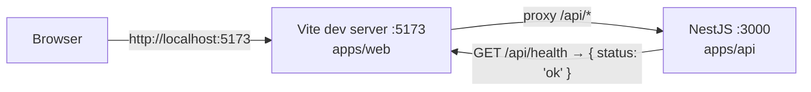

# bay01


## Overview

bay01 is a pnpm monorepo scaffold with two apps. `apps/web` is a Vite + React + TypeScript single-page app styled with Tailwind CSS v4 and shadcn/ui components. `apps/api` is a NestJS service that exposes `GET /api/health`. In development, Vite proxies every `/api` request to Nest, so the browser only talks to one origin. A single `pnpm dev` starts both through **concurrently**. Linting and formatting use the Oxc toolchain (oxlint + oxfmt) instead of ESLint and Prettier. Installs run under pnpm's supply-chain policy: a 24h release quarantine, an explicit build-script allow-list and a trust-downgrade check.



## Repository layout

```text
.
├── apps/
│   ├── web/                    # @bay01/web: Vite + React + Tailwind v4 + shadcn/ui
│   │   ├── components.json     # shadcn/ui config (aliases @/components, @/lib/utils)
│   │   ├── src/
│   │   │   ├── App.tsx         # Card + "Ping API" button that calls /api/health
│   │   │   ├── components/ui/  # shadcn-generated components (button, card)
│   │   │   ├── lib/utils.ts    # cn() helper
│   │   │   └── index.css       # Tailwind import + shadcn theme tokens
│   │   └── vite.config.ts      # React + Tailwind plugins, @ alias, /api proxy
│   └── api/                    # @bay01/api: NestJS
│       ├── src/
│       │   ├── main.ts         # bootstrap, listens on resolvePort()
│       │   ├── app.setup.ts    # global /api prefix + PORT validation, shared with tests
│       │   ├── app.module.ts
│       │   ├── app.setup.spec.ts # PORT parsing unit spec
│       │   └── health/         # HealthController + unit spec
│       └── test/               # e2e spec (supertest)
├── packages/                   # reserved by the workspace glob, empty
├── .oxlintrc.json              # oxlint config
├── .oxfmtrc.jsonc              # oxfmt config
├── .vscode/                    # recommended extensions + format-on-save
├── pnpm-workspace.yaml         # packages, catalogs, supply-chain settings
└── package.json                # root scripts, packageManager pin
```

## Getting started

| Requirement | Version                                                                             |
| ----------- | ----------------------------------------------------------------------------------- |
| Node.js     | `^22.22.3 \|\| ^24.15.0 \|\| >=26.0.0`; `.node-version` pins major **24**           |
| pnpm        | **12.15.0**, pinned in `packageManager`; Corepack or pnpm picks it up automatically |

The Node range is the strictest `engines.node` in the locked dependency tree (`@nestjs/cli` → `@angular-devkit/*`, `@nestjs/schematics`), not just Vite's floor. Because `engineStrict` is on, pnpm refuses to install on any Node outside it.

```bash
pnpm install --frozen-lockfile
pnpm dev
```

Open <http://localhost:5173> and press **Ping API**. The card shows the health payload returned by Nest through the proxy. You can also query either side directly:

```bash
curl -s http://localhost:5173/api/health   # via the Vite proxy
curl -s http://localhost:3000/api/health   # Nest directly
```

Both ports are strict: if 5173 or 3000 is taken, startup fails instead of moving to another port. To move the API, set `PORT` (an integer from 1 to 65535; an unset or blank value means 3000, anything else fails at startup) and update the proxy target in `apps/web/vite.config.ts` to match.

## Scripts

### Root

| Script              | What it does                                                                                 |
| ------------------- | -------------------------------------------------------------------------------------------- |
| `pnpm dev`          | `concurrently -k -n web,api -c cyan,magenta` runs web `dev` and api `start:dev` side by side |
| `pnpm build`        | `pnpm -r build`, which emits `apps/web/dist` and `apps/api/dist`                             |
| `pnpm test`         | `pnpm -r --if-present test` (Nest unit tests)                                                |
| `pnpm test:e2e`     | `pnpm -r --if-present test:e2e` (Nest e2e, `GET /api/health`)                                |
| `pnpm typecheck`    | `pnpm -r --if-present typecheck`                                                             |
| `pnpm lint`         | `oxlint` over the whole workspace                                                            |
| `pnpm lint:fix`     | `oxlint --fix`                                                                               |
| `pnpm format`       | `oxfmt`, which formats files in place                                                        |
| `pnpm format:check` | `oxfmt --check`, which fails on unformatted files                                            |
| `pnpm audit:prod`   | `pnpm audit --prod`, an advisory scan of production dependencies                             |

A bare `pnpm audit` runs pnpm's built-in audit over all dependencies, dev included. That is why the production-only scan is named `audit:prod`.

**concurrently** runs both dev servers in one terminal and prefixes each line with `[web]` (cyan) or `[api]` (magenta). With `-k`, if either process exits the other is stopped too, and one Ctrl-C stops both.

### `apps/web` (`pnpm --filter @bay01/web <script>`)

| Script      | What it does                                 |
| ----------- | -------------------------------------------- |
| `dev`       | Vite dev server on :5173 with the /api proxy |
| `build`     | `tsc -b && vite build` into `dist/`          |
| `typecheck` | `tsc -b --noEmit`                            |
| `preview`   | Serves the production build                  |

### `apps/api` (`pnpm --filter @bay01/api <script>`)

| Script                       | What it does                                     |
| ---------------------------- | ------------------------------------------------ |
| `build`                      | `nest build` into `dist/` (entry `dist/main.js`) |
| `start` / `start:dev`        | Nest app, once or in watch mode                  |
| `start:debug` / `start:prod` | Watch mode with inspector, or `node dist/main`   |
| `test` / `test:watch`        | Vitest unit specs (`src/**/*.spec.ts`)           |
| `test:cov` / `test:debug`    | Coverage via `@vitest/coverage-v8`, or inspector |
| `test:e2e`                   | Vitest e2e specs (`test/*.e2e-spec.ts`)          |
| `typecheck`                  | `tsc -p tsconfig.json --noEmit`                  |

## Toolchain

Versions are the manifest entries. Every one of them resolved to `@latest` at scaffold time, except the pins listed under **Deliberate pins**.

| Tool                                            | Manifest                                | Version    |
| ----------------------------------------------- | --------------------------------------- | ---------- |
| pnpm                                            | `package.json` → `packageManager`       | `12.15.0`  |
| concurrently                                    | `package.json`                          | `^10.0.6`  |
| oxlint                                          | `package.json`                          | `^1.89.0`  |
| oxfmt                                           | `package.json`                          | `^0.74.0`  |
| TypeScript (web)                                | `pnpm-workspace.yaml` → `catalog`       | `^7.0.2`   |
| TypeScript (api)                                | `pnpm-workspace.yaml` → `catalogs.nest` | `^6.0.3`   |
| @types/node                                     | `pnpm-workspace.yaml` → `catalog`       | `^24.19.2` |
| Vite                                            | `apps/web/package.json`                 | `^8.3.5`   |
| @vitejs/plugin-react                            | `apps/web/package.json`                 | `^6.1.2`   |
| React / React DOM                               | `apps/web/package.json`                 | `^19.3.1`  |
| tailwindcss / @tailwindcss/vite                 | `apps/web/package.json`                 | `^4.3.3`   |
| shadcn                                          | `apps/web/package.json`                 | `^4.22.1`  |
| @nestjs/common, core, platform-express, testing | `apps/api/package.json`                 | `^12.2.0`  |
| @nestjs/cli / @nestjs/schematics                | `apps/api/package.json`                 | `^12.0.10` |
| Vitest / @vitest/coverage-v8                    | `apps/api/package.json`                 | `^5.0.5`   |

### Deliberate pins

| Pin                         | Why                                                                                                                                                                                                                                                                         |
| --------------------------- | --------------------------------------------------------------------------------------------------------------------------------------------------------------------------------------------------------------------------------------------------------------------------- |
| TypeScript `^6` for the API | `nest build` with TypeScript 7.0.2 fails: _"TypeScript 7.0 ships the tsc executable only; the compiler API is expected to return in 7.1."_ The `nest` named catalog holds the API on 6.x; the web app uses 7.x. Move the API to `catalog:` once the Nest CLI supports TS 7. |
| `@types/node` `^24`         | Matches the Node 24 runtime in `.node-version`. `@types/node@latest` (26.x) would describe APIs that Node 24 lacks.                                                                                                                                                         |

## Supply-chain policy

The Sociotechnic-maintained starter overrides NestJS 12.2.0's pinned Multer 2.4.0
with 2.5.0 for [GHSA-q7qp-rjg7-q26m](https://github.com/advisories/GHSA-q7qp-rjg7-q26m).
The override is limited to that parent version. Recheck it when updating NestJS
and remove it once the parent includes a patched Multer. The normal release-age,
trust and build-script policies still apply.

All settings live in `pnpm-workspace.yaml`:

| Setting              | Value          | Effect                                                                                                                              |
| -------------------- | -------------- | ----------------------------------------------------------------------------------------------------------------------------------- |
| `minimumReleaseAge`  | `1440`         | Only versions published at least 24h ago can be installed, including transitive ones                                                |
| `allowBuilds`        | `{}`           | Explicit allow-list for dependency install scripts. It is empty because no current dependency needs one                             |
| `strictDepBuilds`    | `true`         | An unreviewed build script fails the install (`ERR_PNPM_IGNORED_BUILDS`) instead of only printing a warning                         |
| `engineStrict`       | `true`         | Refuses to install packages whose `engines` exclude the running Node                                                                |
| `trustPolicy`        | `no-downgrade` | Fails if a version is published with weaker trust evidence (for example, no provenance) than an earlier version of the same package |
| `trustPolicyExclude` | `semver@6.3.1` | Exempts one known-good release, pulled in by Babel through `shadcn`, that the no-downgrade check rejects                            |
| `blockExoticSubdeps` | `true`         | Transitive dependencies may not resolve from git URLs or raw tarballs                                                               |

**Quarantine vs `@latest`.** With a 24h `minimumReleaseAge`, `pnpm add <pkg>@latest` installs the newest version that is at least a day old. That can be one patch behind npm's `latest` dist-tag. This is intentional. A waiting period gives the registry and the community time to spot and unpublish a compromised release before it reaches this repository, though no window guarantees that. Lower or raise the window in `pnpm-workspace.yaml` if you need to.

**Approving a new build script.** When a new dependency ships a `postinstall`/`install` script, `pnpm install` fails and names the package. Review what the script does, then add it explicitly:

```yaml
allowBuilds:
  some-package: true # or false to skip it without failing
```

Approve individual packages. Never enable all build scripts at once.

## Adding components

UI agents start with [AGENTS.md](AGENTS.md) and the bundled
[scaffold-ui skill](.agents/skills/scaffold-ui/SKILL.md). The guide maps installed
components, tokens, typography and composition, with pinned shadcn/Tailwind
references and Radix notes. Those references are implementation guidance; the
approved product design controls the visual direction. Immutable upstream
reference code is excluded from application lint/format checks.

shadcn/ui is configured in `apps/web/components.json` (style `radix-nova`, base color neutral, CSS variables). To add a component:

```bash
cd apps/web
pnpm exec shadcn add <name>   # e.g. dialog, input, dropdown-menu; uses installed CLI
```

**The `cn` helper comes from npm.** In the `radix-nova` style, shadcn 4.22 installs the [`cn`](https://www.npmjs.com/package/cn) package and its components `import { cn } from "cn"`. They do not use a local `clsx` + `tailwind-merge` helper. `src/lib/utils.ts` just re-exports it. The package is published by the `shadcn` npm account from `github.com/shadcn-ui/cn`, with build provenance and no dependencies or install scripts, and `shadcn` itself depends on it. If you have code that relies on `tailwind-merge`'s exact conflict-resolution behaviour, test it against `cn` before you assume parity.

**`shadcn` is a runtime dependency.** `src/index.css` imports `shadcn/tailwind.css`, so the CLI package sits in `dependencies`. Vite bundles only that CSS, but the CLI's install tree (Babel and others) is part of production installs and of `pnpm audit:prod`. That tree is also why `trustPolicyExclude` lists `semver@6.3.1`.

Components land in `apps/web/src/components/ui/` and are imported through the `@` alias (`@/components/ui/<name>`). The CLI writes them in its own style, so oxlint and oxfmt skip that folder. Later `add` runs can't break `pnpm format:check`.

## Lint & format

[Oxc](https://oxc.rs) replaces ESLint and Prettier. No ESLint or Prettier dependency, config or script exists anywhere in the workspace.

- **oxlint** (`.oxlintrc.json`): plugins `typescript`, `import`, `unicorn`, `oxc`. `correctness` rules are errors and `suspicious` rules are warnings. `apps/web/**` adds `react` + `jsx-a11y` with a browser env. `apps/api/**` adds `vitest` with a node env and allows decorator-only classes such as `@Module`.
- **oxfmt** (`.oxfmtrc.jsonc`): single quotes, 100-column print width. Ignores `dist`, `node_modules`, `pnpm-lock.yaml` and the shadcn `ui` folder.

```bash
pnpm lint            # check
pnpm lint:fix        # apply safe fixes
pnpm format          # write
pnpm format:check    # verify (CI-friendly)
```

**VS Code.** `.vscode/extensions.json` recommends `oxc.oxc-vscode` and `bradlc.vscode-tailwindcss`. `.vscode/settings.json` makes Oxc the default formatter, turns on format-on-save, and associates `*.css` with Tailwind's language mode so `@theme`/`@apply` don't show as errors.

## What is not here

- CI workflows, Docker or deployment configuration
- Databases, ORMs, auth or features beyond the health endpoint
- A shared `packages/*` library (the glob is reserved)
- Web unit or e2e tests (Vitest/Playwright for the web app), Storybook
- Type-aware linting (`oxlint-tsgolint`), Husky or lint-staged hooks
- Environment management (`@nestjs/config`, `.env` files) beyond `PORT`
